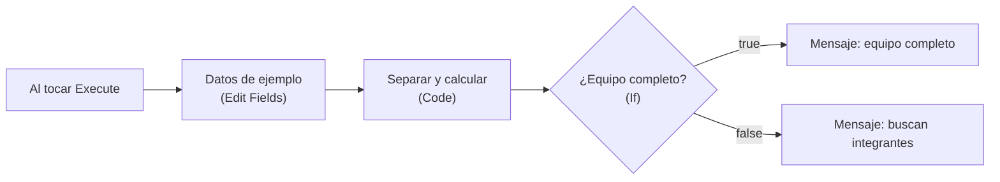

# Hola n8n: datos, expresiones y decisiones

**Fundamentos · inicial · 10 minutos · sin credenciales · probado en n8n 2.48.7**

Tu primer workflow. Tocás un botón y ves cómo viajan los datos de nodo en nodo: se arman, se transforman con JavaScript y toman caminos distintos según una condición. Es la base de todo lo demás.

## Qué hace



1. **Datos de ejemplo** arma un ítem con el evento, la fecha de hoy, el cupo por equipo (4 personas) y una lista de tres equipos.
2. **Separar y calcular** (JavaScript) convierte esa lista en tres ítems, uno por equipo, y calcula cuántos lugares libres le quedan a cada uno.
3. **¿Equipo completo?** revisa cada ítem: los equipos sin lugares libres salen por **true** y el resto por **false**.
4. Cada rama suma un campo `mensaje` armado con una expresión.

## Qué aprendés

- Qué es un **ítem** y cómo pasa de un nodo al siguiente: entra 1 ítem al Code node y salen 3.
- **Expresiones** con `{{ }}`: leer datos con `$json.campo`, la fecha con `$now` y JavaScript corto como `condición ? 'sí' : 'no'`.
- **Edit Fields (Set)** con campos de tipo texto, número y lista.
- El **Code node** en JavaScript, con el código comentado paso a paso.
- **If** con dos ramas.

## Qué necesitás

Nada más que tu n8n: [n8n Cloud](https://app.n8n.cloud/register) o una instalación en tu compu. No usa credenciales ni cuentas externas.

## Cómo importarlo

Elegí una de estas tres formas:

1. **Copiar y pegar.** Abrí [`workflow.json`](workflow.json), tocá **Copy raw file**, abrí un workflow nuevo en n8n, hacé clic en el canvas y pegá con Ctrl + V (Cmd + V en Mac).
2. **Import from URL.** En un workflow nuevo, abrí el menú del workflow (los tres puntos, arriba), elegí **Import from URL** y pegá este enlace:

   ```text
   https://raw.githubusercontent.com/nodo-cero-bo/workflows/main/00-fundamentos/01-hola-n8n/workflow.json
   ```

3. **Import from File.** Bajá el archivo (**Download raw file**) y, en el mismo menú, elegí **Import from File**.

Más detalle en la guía [Importar workflows](https://github.com/nodo-cero-bo/guias/blob/main/00-empezar/02-importar-workflows.md).

## Cómo probarlo

1. Tocá **Execute** (Execute), el botón de abajo del canvas. Todos los nodos se ponen en verde.
2. Fijate en los números sobre las conexiones: 1 ítem hasta el Code node, 3 ítems después, y en el If se reparten 1 por **true** y 2 por **false**.
3. Abrí cada nodo con doble clic. A la izquierda está lo que entra (INPUT) y a la derecha lo que sale (OUTPUT). Probá las vistas **Schema**, **Table** y **JSON**.
4. Abrí **Mensaje: buscan integrantes**. Tenés que ver dos ítems con mensajes como estos:

   ```json
   { "equipo": "Equipo Motacú", "lugares_libres": 1, "mensaje": "Equipo Motacú tiene 1 lugar libre. ¿Te sumás?" }
   { "equipo": "Equipo Guapurú", "lugares_libres": 2, "mensaje": "Equipo Guapurú tiene 2 lugares libres. ¿Te sumás?" }
   ```

5. Ahora cambiá algo: en **Datos de ejemplo**, poné `4` en los integrantes del Equipo Motacú y ejecutá de nuevo. Ese equipo pasa a la rama **true**.

Las notas adhesivas del canvas explican cada paso, con el porqué.

## Ideas para extenderlo

- Sumá un equipo a la lista y un campo nuevo, por ejemplo el nombre del proyecto, y usalo en el mensaje.
- Cambiá el **If** por un **Switch** con tres caminos: completo, le falta una persona, le faltan dos o más.
- En el Code node, ordená los equipos por lugares libres con `sort` antes de devolverlos.
- Reemplazá **Datos de ejemplo** por datos reales: un formulario ([`04-formulario`](../04-formulario)) o una API ([`03-http-request`](../03-http-request)).

## Documentación oficial

- [Build your first workflow](https://docs.n8n.io/build-your-first-workflow)
- [Estructura de datos de n8n (ítems)](https://docs.n8n.io/build/work-with-data/understand-n8ns-data-structure)
- [Expresiones](https://docs.n8n.io/build/work-with-data/transform-data/expressions-for-data-transformation) y [fechas con Luxon](https://docs.n8n.io/build/work-with-data/transform-data/expression-reference/datetime)
- Nodos: [Manual Trigger](https://docs.n8n.io/integrations/builtin/core-nodes/n8n-nodes-base.manualworkflowtrigger), [Edit Fields (Set)](https://docs.n8n.io/integrations/builtin/core-nodes/n8n-nodes-base.set), [Code](https://docs.n8n.io/integrations/builtin/core-nodes/n8n-nodes-base.code) ([cómo usarlo](https://docs.n8n.io/build/code-in-n8n/using-the-code-node)) e [If](https://docs.n8n.io/integrations/builtin/core-nodes/n8n-nodes-base.if)

---

[Catálogo de workflows](../../README.md) · Siguiente: [Tu primera API](../02-mi-primera-api)
