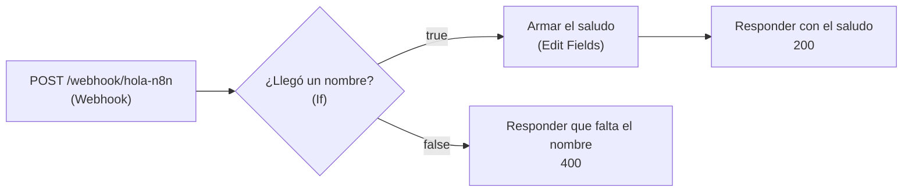

# Tu primera API

**Fundamentos · inicial · 10 minutos · sin credenciales · probado en n8n 2.48.7**

Un Webhook te da una URL propia que recibe datos y contesta en JSON, como cualquier API. Con esto tu app, tu página o cualquier otro servicio pueden hablar con tus workflows.

## Qué hace



Recibe un `POST` en `/webhook/hola-n8n` con un JSON como `{"nombre": "Ada"}` y responde:

```json
{
  "saludo": "Hola, Ada. Te damos la bienvenida a Nodo Cero.",
  "hora": "10:30",
  "fecha": "2026-11-21",
  "zona_horaria": "America/La_Paz"
}
```

Si el nombre no vino o está vacío, responde con el código **400** y un JSON que explica qué mandar.

## Qué aprendés

- El nodo **Webhook**: método `POST`, path propio y dónde llega cada parte del pedido (`$json.body`, `$json.query`, `$json.headers`).
- La diferencia entre la **URL de prueba** y la **URL de producción**.
- Validar el pedido con **If** antes de responder.
- **Respond to Webhook**: responder con el ítem que llega o con un JSON fijo, y elegir el código HTTP (200 o 400).
- La hora de Bolivia con `$now.setZone('America/La_Paz')`.

## Qué necesitás

- Tu n8n ([n8n Cloud](https://app.n8n.cloud/register) o en tu compu). No usa credenciales.
- Una terminal para mandar el pedido: curl (Mac, Linux o Git Bash en Windows) o PowerShell (Windows).

## Cómo importarlo

1. **Copiar y pegar.** Abrí [`workflow.json`](workflow.json), tocá **Copy raw file** y pegá en el canvas de un workflow nuevo con Ctrl + V (Cmd + V en Mac).
2. **Import from URL.** Menú del workflow (los tres puntos, arriba) → **Import from URL**, con este enlace:

   ```text
   https://raw.githubusercontent.com/nodo-cero-bo/workflows/main/00-fundamentos/02-mi-primera-api/workflow.json
   ```

3. **Import from File.** Bajá el archivo y usá **Import from File** en el mismo menú.

## URL de prueba y URL de producción

Abrí el nodo **Recibir el pedido**: arriba tiene dos pestañas con dos URL.

| | URL de prueba (**Test URL**) | URL de producción (**Production URL**) |
|---|---|---|
| Forma | `https://<tu-n8n>/webhook-test/hola-n8n` | `https://<tu-n8n>/webhook/hola-n8n` |
| Cuándo anda | Después de tocar **Execute** o **Listen for test event**, mientras el editor escucha | Cuando el workflow está publicado (botón **Publish**) |
| Cuántos pedidos | Uno por vez: después hay que volver a escuchar | Todos los que lleguen, aunque cierres el editor |
| Dónde ves qué pasó | En vivo, en el canvas | En la pestaña **Executions** |

Mientras armás, usá la de prueba. Para compartir tu API, publicá el workflow y usá la de producción.

## Cómo probarlo

1. Abrí **Recibir el pedido** y copiá la **Test URL**.
2. Tocá **Execute**, abajo del canvas: n8n se queda esperando un pedido.
3. Mandá el pedido desde una terminal, con tu URL.

   Mac, Linux o Git Bash:

   ```bash
   curl -X POST "TU_TEST_URL" \
     -H "Content-Type: application/json" \
     -d '{"nombre":"Ada"}'
   ```

   PowerShell:

   ```powershell
   Invoke-RestMethod -Method Post `
     -Uri "TU_TEST_URL" `
     -ContentType "application/json" `
     -Body '{"nombre":"Ada"}'
   ```

4. La terminal muestra el saludo con la hora de Bolivia, y el canvas, el camino que hizo el pedido.
5. Probá el error: volvé a tocar **Execute** y mandá `{}` en vez de `{"nombre":"Ada"}`. La respuesta tiene el código 400. En PowerShell aparece como un error en rojo con el JSON de la respuesta: es lo esperado.
6. Publicá el workflow con **Publish**, copiá la **Production URL** y repetí el pedido: ahora responde siempre, sin tocar **Execute**, y cada pedido queda en **Executions**.

## Ideas para extenderlo

- Sumá campos al pedido (por ejemplo `equipo`) y devolvelos en la respuesta.
- Aceptá también `GET` con `?nombre=Ada`: en el Webhook, activá **Allow Multiple HTTP Methods** y leé `$json.query.nombre`.
- Protegé tu API: en el Webhook, **Authentication** → **Header Auth**, y pedí un header con una clave.
- Guardá cada pedido en una base: [`31-api-crud-supabase`](../../30-supabase/31-api-crud-supabase) arma una API completa sobre Supabase.

## Documentación oficial

- [Webhook](https://docs.n8n.io/integrations/builtin/core-nodes/n8n-nodes-base.webhook), [desarrollo con la URL de prueba y la de producción](https://docs.n8n.io/integrations/builtin/core-nodes/n8n-nodes-base.webhook/workflow-development) y [problemas comunes](https://docs.n8n.io/integrations/builtin/core-nodes/n8n-nodes-base.webhook/common-issues)
- [Respond to Webhook](https://docs.n8n.io/integrations/builtin/core-nodes/n8n-nodes-base.respondtowebhook)
- [If](https://docs.n8n.io/integrations/builtin/core-nodes/n8n-nodes-base.if) y [Edit Fields (Set)](https://docs.n8n.io/integrations/builtin/core-nodes/n8n-nodes-base.set)
- [Fechas y horas en expresiones](https://docs.n8n.io/build/work-with-data/transform-data/expression-reference/datetime)

---

[Catálogo de workflows](../../README.md) · Anterior: [Hola n8n](../01-hola-n8n) · Siguiente: [HTTP Request](../03-http-request)
