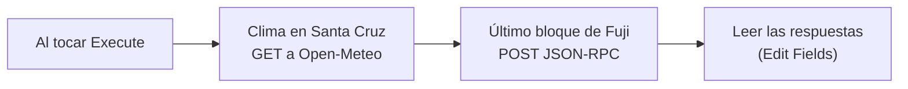

# Llamar a cualquier API con HTTP Request

**Fundamentos · inicial · 15 minutos · sin credenciales · probado en n8n 2.48.7**

**HTTP Request** es el nodo que conecta n8n con cualquier servicio que tenga una API, aunque no tenga un nodo propio. Este workflow hace dos pedidos reales, sin claves ni cuentas: el clima de ahora en Santa Cruz de la Sierra y el último bloque de la red de prueba de Avalanche, Fuji. Es la base del workshop de HTTP Request del día.

## Qué hace



1. **Clima en Santa Cruz**: un `GET` a [Open-Meteo](https://open-meteo.com/en/docs) con parámetros en la URL. Trae la temperatura, la humedad y el viento de ahora.
2. **Último bloque de Fuji**: un `POST` con un cuerpo JSON al RPC público de Avalanche Fuji (`https://api.avax-test.network/ext/bc/C/rpc`), con el método `eth_blockNumber`. Trae el número del último bloque, en hexadecimal.
3. **Leer las respuestas**: saca de cada respuesta lo que importa y lo deja en campos claros. El resultado se ve así:

```json
{
  "temperatura_c": 27.3,
  "humedad_pct": 78,
  "viento_kmh": 18.4,
  "hora_del_dato": "2026-11-21T01:45",
  "bloque_hex": "0x3a91273",
  "bloque_fuji": 61411955,
  "resumen": "En Santa Cruz hay 27,3 °C y Fuji va por el bloque 61.411.955."
}
```

## Qué aprendés

- Las partes de un pedido HTTP: **método**, **URL**, **query parameters**, **headers** y **body**.
- Un `GET` a una API pública sin clave, con los parámetros en **Send Query Parameters**.
- Un `POST` con **JSON-RPC**, el formato con el que se consulta una blockchain como Avalanche.
- Leer la respuesta: datos anidados (`current.temperature_2m`), datos de otro nodo (`$('Clima en Santa Cruz').item.json...`) y un hexadecimal pasado a decimal (`parseInt(hex, 16)`).
- Qué hacer cuando una API falla o pide clave.

## Qué necesitás

Nada más que tu n8n ([n8n Cloud](https://app.n8n.cloud/register) o en tu compu). Las dos APIs son públicas y no piden clave.

## Cómo importarlo

1. **Copiar y pegar.** Abrí [`workflow.json`](workflow.json), tocá **Copy raw file** y pegá en el canvas de un workflow nuevo con Ctrl + V (Cmd + V en Mac).
2. **Import from URL.** Menú del workflow (los tres puntos, arriba) → **Import from URL**, con este enlace:

   ```text
   https://raw.githubusercontent.com/nodo-cero-bo/workflows/main/00-fundamentos/03-http-request/workflow.json
   ```

3. **Import from File.** Bajá el archivo y usá **Import from File** en el mismo menú.

## Cómo probarlo

1. Tocá **Execute workflow**, abajo del canvas.
2. Abrí **Clima en Santa Cruz** y mirá el OUTPUT en la vista **JSON**: así responde Open-Meteo. Los datos de ahora están dentro de `current`.
3. Abrí **Último bloque de Fuji**: la respuesta es `{"result": "0x...", "id": 1, "jsonrpc": "2.0"}`.
4. Abrí **Leer las respuestas**: cada campo es una expresión. Arrastrá otro campo del INPUT hasta un valor nuevo y mirá la expresión que escribe n8n.
5. Ejecutá otra vez en un minuto: el número de bloque sube (Fuji suma bloques cada pocos segundos).

## Las partes de un pedido, en este workflow

| Parte | En el GET del clima | En el POST a Fuji |
|---|---|---|
| Método | `GET`: leer | `POST`: mandar datos |
| URL | `https://api.open-meteo.com/v1/forecast` | `https://api.avax-test.network/ext/bc/C/rpc` |
| Query parameters | `latitude`, `longitude`, `current`, `timezone` | ninguno |
| Headers | ninguno | `Content-Type: application/json` |
| Body | ninguno | `{"jsonrpc": "2.0", "id": 1, "method": "eth_blockNumber", "params": []}` |

El header importa: sin `Content-Type: application/json`, el RPC de Fuji responde con el código **415** y el mensaje `only application/json is supported`. La respuesta de cualquier API trae un **código** (2xx salió bien, 4xx el pedido tiene un problema, 5xx falló el servidor) y un **cuerpo**, que n8n convierte en ítems.

Un HTTP Request se ejecuta una vez por cada ítem que le llega: con 10 ítems, hace 10 pedidos.

## Ejercicios para el workshop

1. **Tu ciudad.** Cambiá `latitude` y `longitude`. Por ejemplo, La Paz: `-16.50` y `-68.15`.
2. **El pronóstico.** Duplicá **Clima en Santa Cruz** (Ctrl + D) y, en la copia, cambiá `current` por `daily` con el valor `temperature_2m_max,precipitation_probability_max` y sumá el parámetro `forecast_days` con `3`. La respuesta trae la máxima y la probabilidad de lluvia de tres días.
3. **Otro método del RPC.** En el body del POST, cambiá `eth_blockNumber` por `eth_chainId`. Responde `0xa869`, que en decimal es `43113`: el número que identifica a Fuji. Probá también `eth_gasPrice`.
4. **Import cURL.** Creá un HTTP Request nuevo, tocá **Import cURL** y pegá esto. n8n completa el método, la URL y los parámetros a partir del comando:

   ```bash
   curl "https://api.open-meteo.com/v1/forecast?latitude=-16.50&longitude=-68.15&current=temperature_2m"
   ```

5. **Ver el código de respuesta.** En **Options** → **Response**, activá **Include Response Headers and Status**: el OUTPUT suma `statusCode` y `headers`.
6. **Si la API falla.** En **Settings** del nodo, activá **Retry On Fail**, o elegí **On Error** → **Continue (using error output)** para que el error salga por una rama aparte.

## Cuando una API pide clave

No pegues la clave en un header a mano: queda a la vista de quien vea el workflow. En el HTTP Request, elegí **Authentication** → **Generic Credential Type** y, por ejemplo, **Header Auth** (nombre del header y valor). n8n la guarda cifrada como credencial y no viaja cuando compartís el workflow.

## Ideas para extenderlo

- Un aviso del clima: con un **Schedule Trigger** y un **If**, que avise cuando la probabilidad de lluvia pase de un límite.
- Leé el saldo de una wallet en Fuji con `eth_getBalance`: está armado en [`11-fuji-saldo-wallet`](../../10-avalanche-fuji/11-fuji-saldo-wallet).
- El estado completo de la red (chainId, bloque y gas): [`10-fuji-estado-de-la-red`](../../10-avalanche-fuji/10-fuji-estado-de-la-red).
- Dale el HTTP Request a un agente de IA como herramienta: [`40-agente-web3-fuji`](../../40-proyectos/40-agente-web3-fuji).

## Documentación oficial

- [HTTP Request](https://docs.n8n.io/integrations/builtin/core-nodes/n8n-nodes-base.httprequest), [problemas comunes](https://docs.n8n.io/integrations/builtin/core-nodes/n8n-nodes-base.httprequest/common-issues) y [credenciales para HTTP Request](https://docs.n8n.io/integrations/builtin/credentials/httprequest)
- [Expresiones](https://docs.n8n.io/build/work-with-data/transform-data/expressions-for-data-transformation)
- [API de Open-Meteo](https://open-meteo.com/en/docs)
- [JSON-RPC y sus métodos (`eth_blockNumber`, `eth_chainId`...)](https://ethereum.org/developers/docs/apis/json-rpc/): Avalanche C-Chain usa los mismos.
- [Explorador de Fuji](https://build.avax.network/explorer/fuji/c-chain), para ver los bloques que leés.

---

[Catálogo de workflows](../../README.md) · Anterior: [Tu primera API](../02-mi-primera-api) · Siguiente: [Un formulario de n8n](../04-formulario)
