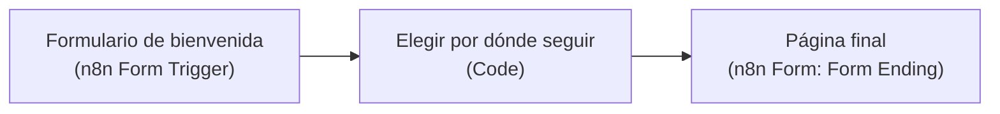

# Un formulario de n8n

**Fundamentos · inicial · 10 minutos · sin credenciales · probado en n8n 2.48.7**

Un formulario con una URL propia, que cualquiera abre desde el celular, con los colores de Nodo Cero. n8n procesa cada respuesta y muestra una página final hecha para esa persona. Sin escribir HTML y sin servidor propio.

## Qué hace



1. **Formulario de bienvenida** pregunta tres cosas, las tres obligatorias: tu nombre, qué querés construir y tu nivel con n8n (un desplegable).
2. **Elegir por dónde seguir** (JavaScript) busca palabras clave en la idea (por ejemplo «chat», «pago» o «login») y elige por qué workflow del catálogo conviene seguir, según el tema y el nivel.
3. **Página final** saluda por el nombre y muestra la recomendación, con un enlace al catálogo.

Por ejemplo, si Ada escribe «un asistente que responda las preguntas de mi curso» y elige «Es mi primera vez», la página final dice:

> **Gracias, Ada**
>
> Tu idea suena a **IA**. Empezá por **01-hola-n8n** y seguí con **05-agente-ia**.

## Qué aprendés

- **n8n Form Trigger**: campos de texto, de texto largo y desplegables, obligatorios, con **Field Name** para que cada dato tenga un nombre corto en la salida.
- Procesar la respuesta con un **Code node** (buscar palabras, elegir según una opción).
- La página final con el nodo **n8n Form** en la operación **Form Ending**, armada con expresiones y HTML simple.
- Darle tu estilo al formulario con CSS (**Custom Form Styling**).
- La URL de prueba y la de producción de un formulario.

## Qué necesitás

Nada más que tu n8n ([n8n Cloud](https://app.n8n.cloud/register) o en tu compu). No usa credenciales.

## Cómo importarlo

1. **Copiar y pegar.** Abrí [`workflow.json`](workflow.json), tocá **Copy raw file** y pegá en el canvas de un workflow nuevo con Ctrl + V (Cmd + V en Mac).
2. **Import from URL.** Menú del workflow (los tres puntos, arriba) → **Import from URL**, con este enlace:

   ```text
   https://raw.githubusercontent.com/nodo-cero-bo/workflows/main/00-fundamentos/04-formulario/workflow.json
   ```

3. **Import from File.** Bajá el archivo y usá **Import from File** en el mismo menú.

## Cómo probarlo

1. Tocá **Execute**, abajo del canvas: se abre el formulario de prueba en una pestaña nueva.
2. Completalo y tocá **Enviar**. Probá con ideas distintas: «un bot para mi emprendimiento», «verificar pagos en Fuji», «un login para socias», «guardar el inventario en una tabla».
3. Mirá la página final y, de vuelta en el canvas, lo que salió de cada nodo.
4. Para compartirlo: tocá **Publish**, abrí **Formulario de bienvenida** y copiá la **Production URL** (termina en `/form/nodo-cero-bienvenida`). Esa URL anda siempre, aunque cierres el editor, y cada respuesta queda en **Executions**.

> La URL de prueba (`/form-test/...`) anda nada más mientras el editor está esperando, después de tocar **Execute**. La de producción (`/form/...`) anda cuando el workflow está publicado.

## Cómo está hecho el estilo

En **Options** → **Custom Form Styling** del formulario (y también en la página final) hay unas líneas de CSS que cambian las variables de colores de n8n por la paleta de Nodo Cero: fondo `#191919`, tarjeta `#242424`, texto `#FAFAFA` y rosa `#FF91AC` en el botón. Cambiá esos colores por los de tu proyecto. Si borrás el CSS, el formulario vuelve al estilo de n8n.

## Ideas para extenderlo

- Sumá campos: un correo (tipo **Email**), una fecha o casillas (**Checkboxes**) con las tecnologías que te interesan.
- Agregá una segunda página con otro nodo **n8n Form** (operación **Next Form Page**) antes de la página final, para preguntar más según lo que respondió la persona.
- Guardá cada respuesta en una base de datos: [`30-formulario-a-supabase`](../../30-supabase/30-formulario-a-supabase).
- Que la IA lea la idea y la clasifique: [`34-supabase-webhook-ia`](../../30-supabase/34-supabase-webhook-ia), o la guía [Formularios inteligentes](https://github.com/nodo-cero-bo/guias/blob/main/proyectos/05-formularios-inteligentes.md).

## Documentación oficial

- [n8n Form Trigger](https://docs.n8n.io/integrations/builtin/core-nodes/n8n-nodes-base.formtrigger)
- [n8n Form (páginas y Form Ending)](https://docs.n8n.io/integrations/builtin/core-nodes/n8n-nodes-base.form)
- [Code](https://docs.n8n.io/integrations/builtin/core-nodes/n8n-nodes-base.code) y [cómo usarlo](https://docs.n8n.io/build/code-in-n8n/using-the-code-node)
- [Expresiones](https://docs.n8n.io/build/work-with-data/transform-data/expressions-for-data-transformation)

---

[Catálogo de workflows](../../README.md) · Anterior: [HTTP Request](../03-http-request) · Siguiente: [Tu primer agente de IA](../05-agente-ia)
