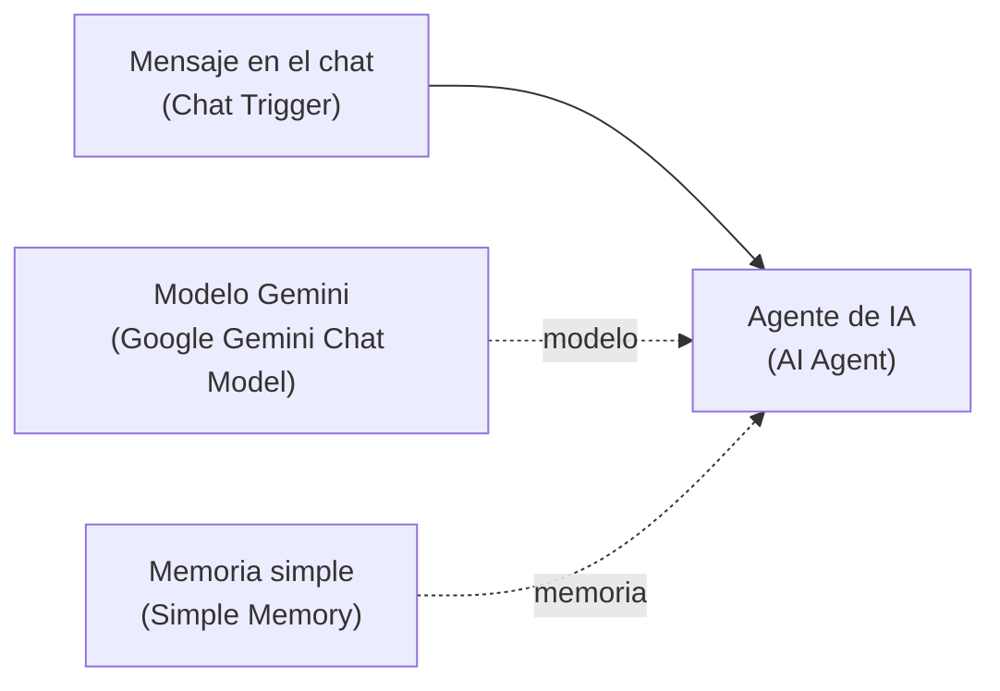

# Tu primer agente de IA

**IA · inicial · 15 minutos · credencial: Google Gemini (clave gratis) · auditado en n8n 2.48.7**

Un asistente que conversa en el chat de n8n, recuerda lo que le dijiste y responde como el asistente de Nodo Cero. Cambiando un texto, el mensaje de sistema, lo convertís en el asistente de tu comunidad, tu negocio o tu materia.

## Qué hace



1. **Mensaje en el chat** recibe lo que escribís en el chat de n8n (**Open chat**, abajo del canvas).
2. **Agente de IA** le suma el historial de la conversación y le pide la respuesta al modelo, siguiendo el mensaje de sistema: quién es, qué datos del evento puede usar y cómo responder (en español, con voseo, sin inventar).
3. **Modelo Gemini** es el modelo de lenguaje: viene elegido `models/gemini-3.5-flash-lite`.
4. **Memoria simple** guarda los últimos 10 mensajes de cada conversación, así el agente se acuerda de lo que hablaron.

## Qué aprendés

- **Chat Trigger** y el chat de prueba del editor.
- **AI Agent** y cómo el **mensaje de sistema** cambia su comportamiento.
- **Google Gemini Chat Model**: conectar la credencial y elegir el modelo.
- **Simple Memory** y el `sessionId` que separa cada conversación.
- Cómo cambiar Gemini por OpenAI.

## Qué necesitás

- Tu n8n ([n8n Cloud](https://app.n8n.cloud/register) o en tu compu).
- Una clave gratis de la API de Gemini, de [Google AI Studio](https://aistudio.google.com/apikey).
- La credencial **Google Gemini(PaLM) Api** (tipo `googlePalmApi`) en n8n:

| Campo | Qué va |
|---|---|
| **Host** | Dejá el que viene: `https://generativelanguage.googleapis.com` |
| **API Key** | Tu clave de Google AI Studio |

Paso a paso, y qué hacer si algo falla: guía [Tu clave de Gemini](https://github.com/nodo-cero-bo/guias/blob/main/00-empezar/07-clave-gemini.md).

> El nivel gratuito de la API de Gemini alcanza para la hackathon. En ese nivel, Google puede usar lo que mandás para mejorar sus productos: no le mandes datos personales ni sensibles de nadie.

## Cómo importarlo

1. **Copiar y pegar.** Abrí [`workflow.json`](workflow.json), tocá **Copy raw file** y pegá en el canvas de un workflow nuevo con Ctrl + V (Cmd + V en Mac).
2. **Import from URL.** Menú del workflow (los tres puntos, arriba) → **Import from URL**, con este enlace:

   ```text
   https://raw.githubusercontent.com/nodo-cero-bo/workflows/main/00-fundamentos/05-agente-ia/workflow.json
   ```

3. **Import from File.** Bajá el archivo y usá **Import from File** en el mismo menú.

El workflow no trae credenciales: el nodo **Modelo Gemini** aparece con una advertencia hasta que elegís la tuya.

## Cómo probarlo

1. Abrí **Modelo Gemini**. En **Credential**, elegí **Create new credential**, pegá tu clave en **API Key** y guardá. Tiene que decir que la conexión funciona.
2. Tocá **Open chat**, abajo del canvas.
3. Escribí «Hola, ¿qué podés hacer por mí?».
4. Seguí con «¿A qué hora es el almuerzo?» y después con «¿Qué te pregunté recién?»: gracias a la memoria, se acuerda.
5. Abrí **Agente de IA** y mirá los registros (**Logs**): qué recibió el modelo, qué contestó y cuánto tardó.
6. Ahora, la mitad de la magia: en **Agente de IA** → **Options** → **System Message**, reescribí quién es el asistente para tu proyecto y probá de nuevo.

## El modelo: cuál viene y cómo cambiarlo

Viene elegido **`models/gemini-3.5-flash-lite`**. Al 21 de noviembre de 2026 es un modelo estable de Google, sin fecha de retiro anunciada, con nivel gratuito, rápido y recomendado para proyectos nuevos ([lista de modelos](https://aistudio.google.com/docs/models) y [precios](https://aistudio.google.com/docs/pricing)).

Para elegir otro, abrí **Modelo Gemini** y desplegá **Model**: la lista se carga desde tu cuenta cuando la credencial está lista, así que muestra los modelos que tu clave puede usar hoy. Google retira modelos viejos cada tanto: si el nodo dice que no encuentra el modelo, elegí otro de la lista. Los de la familia **Flash** y **Flash-Lite** tienen nivel gratuito y responden rápido.

### Con OpenAI en vez de Gemini

1. Creá una clave en [platform.openai.com/api-keys](https://platform.openai.com/api-keys). La API de OpenAI se paga por uso: la cuenta necesita saldo.
2. Borrá **Modelo Gemini** y conectá un **OpenAI Chat Model** en la entrada **Chat Model** del agente.
3. Creá la credencial **OpenAI** (tipo `openAiApi`) con tu clave y probá con **Open chat**.

## Cómo se probó

El workflow pasa el auditor y se importa en n8n 2.48.7. Sin una clave real no se puede llamar a Gemini, así que se probó de punta a punta contra un servidor local que imita la API de Gemini, con una credencial que apuntaba a ese servidor: el chat llegó al agente, el pedido salió al modelo `gemini-3.5-flash-lite` con el mensaje de sistema y la clave en su lugar, la memoria sumó el historial en cada mensaje y dos conversaciones distintas no se mezclaron.

## Ideas para extenderlo

- **Herramientas**: conectá un **HTTP Request Tool** en la entrada **Tool** del agente para que consulte una API cuando lo necesite. Mirá [`40-agente-web3-fuji`](../../40-proyectos/40-agente-web3-fuji).
- **Tus documentos**: que el agente busque en tus PDF y apuntes guardados en Supabase, con [`33-agente-con-memoria-y-rag`](../../30-supabase/33-agente-con-memoria-y-rag).
- **Memoria que dura**: Simple Memory se borra si n8n se reinicia; **Postgres Chat Memory** con Supabase la guarda de verdad (también en el workflow 33).
- **Chat público**: en **Mensaje en el chat**, activá **Make Chat Publicly Available**, publicá con **Publish** y compartí la URL del chat.
- Guía de proyecto: [Asistente con IA para tu comunidad](https://github.com/nodo-cero-bo/guias/blob/main/proyectos/01-asistente-ia-para-tu-comunidad.md).

## Documentación oficial

- [Chat Trigger](https://docs.n8n.io/integrations/builtin/core-nodes/n8n-nodes-langchain.chattrigger)
- [AI Agent](https://docs.n8n.io/integrations/builtin/cluster-nodes/root-nodes/n8n-nodes-langchain.agent)
- [Google Gemini Chat Model](https://docs.n8n.io/integrations/builtin/cluster-nodes/sub-nodes/n8n-nodes-langchain.lmchatgooglegemini) y [credencial de Google Gemini](https://docs.n8n.io/integrations/builtin/credentials/googleai)
- [Simple Memory](https://docs.n8n.io/integrations/builtin/cluster-nodes/sub-nodes/n8n-nodes-langchain.memorybufferwindow) y [cómo funciona la memoria](https://docs.n8n.io/build/integrate-ai/understand-ai-components/how-memory-works)
- [IA en n8n](https://docs.n8n.io/build/integrate-ai)

---

[Catálogo de workflows](../../README.md) · Anterior: [Un formulario de n8n](../04-formulario)
