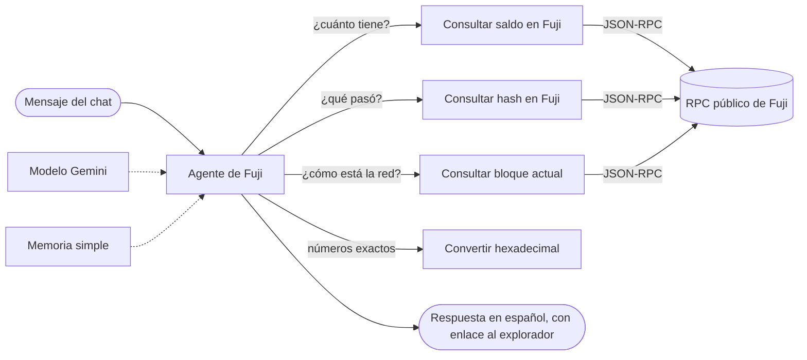

# Agente de IA para Fuji

Un chat con un agente de IA que responde en español preguntas sobre **Avalanche Fuji**, la red de prueba de Avalanche: cuánto tiene una dirección, qué pasó en una transacción o cuál es el último bloque. El agente decide qué herramienta usar, lee la red en vivo, pasa los montos de wei a AVAX sin errores de redondeo y cierra con el enlace al explorador.

Junta **n8n**, **IA (Google Gemini)** y **Avalanche Fuji**: es una base buena para el track de Fuji, que tiene mención especial para los equipos que integren Fuji.



El agente nada más **lee**: no firma ni manda transacciones, y nunca necesita tu frase de recuperación ni tu clave privada.

## Qué aprendés

- Cómo un **AI Agent** elige herramientas a partir de su descripción.
- A convertir un **HTTP Request** en herramienta y a dejar que el modelo complete los datos con `$fromAI()`.
- A mandar un **lote JSON-RPC** (varios pedidos en una sola llamada) al RPC público de Fuji.
- Por qué la cuenta de wei a AVAX la hace JavaScript con **BigInt** en una **Code Tool** y no el modelo.
- Cómo la **memoria simple** guarda cada conversación para poder repreguntar.

## Qué necesitás

| Qué | Para qué | Cómo |
|---|---|---|
| Tu n8n (n8n Cloud o una propia) | Correr el workflow | Probado en n8n 2.48.7. |
| Credencial **Google Gemini(PaLM) Api** (tipo `googlePalmApi`) | El modelo del agente | Creá una clave gratis en [Google AI Studio](https://aistudio.google.com/apikey) y pegala en **API Key** (Host queda como viene). Guía paso a paso: [clave de Gemini](https://github.com/nodo-cero-bo/guias/blob/main/00-empezar/07-clave-gemini.md). |
| Una dirección y un hash de Fuji | Para preguntar | Los de tu [Core Wallet](https://core.app/?utm_source=nodo-cero&utm_medium=github&utm_campaign=hackathon-n8n-bolivia-2026) en modo testnet, o cualquiera del [explorador de Fuji](https://build.avax.network/explorer/fuji/c-chain?utm_source=nodo-cero&utm_medium=github&utm_campaign=hackathon-n8n-bolivia-2026). |

El RPC público de Fuji (`https://api.avax-test.network/ext/bc/C/rpc`, chainId 43113) no pide clave.

¿Preferís OpenAI? Cambiá **Modelo Gemini** por **OpenAI Chat Model** con una credencial `openAiApi`. Las herramientas y la memoria quedan igual.

## Cómo importarlo

Elegí una de estas tres formas:

1. **Copiar y pegar**: abrí [`workflow.json`](workflow.json), copiá todo y pegalo con Ctrl+V (Cmd+V en Mac) en un canvas vacío de n8n.
2. **Desde una URL**: en un workflow nuevo, abrí el menú de los tres puntos (arriba a la derecha), elegí **Import** y después **From URL** (en algunas versiones, **Import from URL**), y pegá este enlace:

   ```text
   https://raw.githubusercontent.com/nodo-cero-bo/workflows/main/40-proyectos/40-agente-web3-fuji/workflow.json
   ```

3. **Archivo**: descargá `workflow.json` y elegí **Import** y después **From file**.

Más detalle en la guía [Importar workflows](https://github.com/nodo-cero-bo/guias/blob/main/00-empezar/02-importar-workflows.md).

## Cómo probarlo

1. Abrí **Modelo Gemini** y elegí (o creá) tu credencial **Google Gemini(PaLM) Api**. Si tu clave no tiene el modelo que viene elegido, elegí otro de la lista.
2. Tocá **Open chat**, abajo del canvas.
3. Probá estas preguntas, una por vez:

   ```text
   ¿Cuál es el último bloque de Fuji?
   ¿Cuánto AVAX tiene 0x...?
   Explicame la transacción 0x... como si nunca hubiera usado una wallet.
   ¿Y cuánto gas usó?
   ```

4. Después de cada respuesta, abrí la ejecución (pestaña **Executions** o el panel de registros del chat) y mirá qué herramienta eligió el agente, con qué datos la llamó y qué le devolvió la red.
5. Compará con el explorador: abrí el enlace que te dio el agente y fijate que el monto y el estado coincidan.

Para compartirlo: en **Mensaje del chat**, activá **Make Chat Publicly Available**, publicá con **Publish** y compartí la URL del chat.

### Qué hace cada pieza

| Nodo | Qué hace |
|---|---|
| **Mensaje del chat** | Recibe cada mensaje y su `sessionId` (una conversación). |
| **Agente de Fuji** | Decide qué herramientas usar y arma la respuesta. Su **mensaje de sistema** (Options → System Message) le dice cómo trabajar: usar siempre las herramientas, no hacer cuentas de cabeza, explicar simple y cerrar con el explorador. |
| **Modelo Gemini** | El modelo que piensa. Temperatura baja (0.2) para que no invente. |
| **Memoria simple** | Los últimos 10 mensajes de cada conversación. |
| **Consultar saldo en Fuji** | `eth_getBalance` de la dirección que completa el modelo. |
| **Consultar hash en Fuji** | Un lote con `eth_getTransactionByHash` y `eth_getTransactionReceipt`: la transacción y si salió bien. |
| **Consultar bloque actual** | Un lote con `eth_blockNumber` y `eth_gasPrice`. |
| **Convertir hexadecimal** | Code Tool: pasa números `0x...` a decimal, a AVAX y a gwei con BigInt. |

## Cómo lo probamos

En una n8n 2.48.7 local: el workflow se importa sin errores y pasa el auditor del repo. Llamadas por el agente, las tres herramientas HTTP leyeron de verdad el RPC público de Fuji, la de conversión devolvió los montos exactos en AVAX y la memoria guardó la conversación de cada sesión, también entrando por el chat publicado. Para no depender de una clave, el modelo se reemplazó por uno de prueba local que pide cada herramienta: con Gemini necesitás tu credencial, por eso figura como **auditado**.

## Ideas para extenderlo

- **Saldo de tokens**: sumá una herramienta con `eth_call` para leer un token ERC-20 (mirá [`15-fuji-token-erc20`](../../10-avalanche-fuji/15-fuji-token-erc20)).
- **Eventos de un contrato**: con `eth_getLogs`, que el agente cuente las últimas transferencias (mirá [`16-fuji-eventos-contrato`](../../10-avalanche-fuji/16-fuji-eventos-contrato)).
- **Verificar pagos**: una herramienta que use las reglas de [`41-pagos-fuji-con-login`](../41-pagos-fuji-con-login) para contestar «¿me pagaron?».
- **Otro público**: cambiá el mensaje de sistema para comercios, para estudiantes o para quien nunca usó una wallet.
- **En tu página**: con el chat público en modo webhook y el paquete `@n8n/chat`, el agente vive dentro de tu sitio.

La guía de proyecto [Agente Web3 que lee Fuji](https://github.com/nodo-cero-bo/guias/blob/main/proyectos/04-agente-web3-que-lee-fuji.md) sigue estos pasos con más detalle y trae ideas para presentarlo.

## Avalanche Fuji

- **Descargá Core Wallet**: [core.app](https://core.app/?utm_source=nodo-cero&utm_medium=github&utm_campaign=hackathon-n8n-bolivia-2026). En Core, abrí **Settings** (el engranaje) y activá **Testnet Mode**: pasa a Fuji por su cuenta. Paso a paso en la guía [Core Wallet y Fuji](https://github.com/nodo-cero-bo/guias/blob/main/00-empezar/06-core-wallet-y-fuji.md).
- **Pedí AVAX de prueba** en el [faucet de Fuji](https://build.avax.network/console/primary-network/faucet?utm_source=nodo-cero&utm_medium=github&utm_campaign=hackathon-n8n-bolivia-2026).
- **Aprendé en Avalanche Academy**: [cursos para desarrolladoras y para emprender](https://build.avax.network/academy?utm_source=nodo-cero&utm_medium=github&utm_campaign=hackathon-n8n-bolivia-2026).
- **Sumate a Team1 LATAM**: [team1.network](https://www.team1.network/?utm_source=nodo-cero&utm_medium=github&utm_campaign=hackathon-n8n-bolivia-2026).
- **Explorá tus transacciones** en el [explorador de Fuji](https://build.avax.network/explorer/fuji/c-chain?utm_source=nodo-cero&utm_medium=github&utm_campaign=hackathon-n8n-bolivia-2026).

## Documentación oficial

- [AI Agent](https://docs.n8n.io/integrations/builtin/cluster-nodes/root-nodes/n8n-nodes-langchain.agent/), [Chat Trigger](https://docs.n8n.io/integrations/builtin/core-nodes/n8n-nodes-langchain.chattrigger/), [Google Gemini Chat Model](https://docs.n8n.io/integrations/builtin/cluster-nodes/sub-nodes/n8n-nodes-langchain.lmchatgooglegemini/) y [Simple Memory](https://docs.n8n.io/integrations/builtin/cluster-nodes/sub-nodes/n8n-nodes-langchain.memorybufferwindow/) en n8n.
- [HTTP Request Tool](https://docs.n8n.io/integrations/builtin/cluster-nodes/sub-nodes/n8n-nodes-langchain.toolhttprequest/), [Code Tool](https://docs.n8n.io/integrations/builtin/cluster-nodes/sub-nodes/n8n-nodes-langchain.toolcode/) y [la función `$fromAI()`](https://docs.n8n.io/advanced-ai/examples/using-the-fromai-function/).
- [Credencial de Google Gemini en n8n](https://docs.n8n.io/integrations/builtin/credentials/googleai/).
- [API JSON-RPC de la C-Chain de Avalanche](https://build.avax.network/docs/rpcs/c-chain?utm_source=nodo-cero&utm_medium=github&utm_campaign=hackathon-n8n-bolivia-2026).

---

Licencia MIT, como todo el repo. n8n, Google Gemini, Avalanche, Core y Team1 son marcas de sus dueños.
