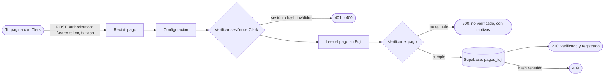

# Pagos en Fuji con login

Una API de n8n para tu página: la persona inicia sesión con **Clerk**, manda el hash de su pago en **Avalanche Fuji** y n8n verifica su sesión, revisa el pago en la red (estado, destino, monto y confirmaciones) y, si está todo bien, lo registra en **Supabase** a su nombre. Responde JSON con el resultado y el motivo.

Junta **Clerk**, **Avalanche Fuji** y **Supabase** en un caso que cualquiera entiende: cobrar y comprobar el pago sin depender de una captura de pantalla.



## Qué aprendés

- A verificar el **token de sesión de Clerk** (un JWT firmado con RS256) con la clave pública PEM de tu aplicación, en un Code node: firma, vencimiento (`exp`, `nbf`) y origen (`azp`).
- A armar una API con **Webhook** y **Respond to Webhook** que responde con códigos HTTP claros.
- A leer un pago en Fuji con un **lote JSON-RPC**: la transacción, su recibo y el último bloque en una sola llamada.
- A comparar montos en wei con **BigInt**, sin perder precisión.
- A registrar en **Supabase** sin duplicados: el nodo sigue de largo si Supabase rechaza un hash repetido (**On Error**) y el workflow responde 409.

## Qué necesitás

| Qué | Para qué | Dónde |
|---|---|---|
| Tu n8n | Correr y publicar la API | Probado en n8n 2.48.7. |
| Credencial **Supabase API** (tipo `supabaseApi`) | Registrar el pago | En Supabase, **Project Settings → API Keys**: la URL del proyecto va en **Host** y la **Secret key** (`sb_secret_...`) o la `service_role` en **Secret Key**. |
| Tabla `pagos_fuji` | Donde queda el registro | Corré el SQL de [`supabase/sql`](../../supabase/sql). |
| **JWKS Public Key** de Clerk, en formato PEM | Verificar las sesiones | En Clerk, página **API keys**. No es una credencial de n8n: se pega en el nodo **Configuración**. Guía: [tu aplicación en Clerk](https://github.com/nodo-cero-bo/guias/blob/main/00-empezar/05-cuenta-clerk.md). |
| Una dirección de Fuji que cobra y un pago de prueba | Probarlo de punta a punta | [Core Wallet](https://core.app/?utm_source=nodo-cero&utm_medium=github&utm_campaign=hackathon-n8n-bolivia-2026) en Testnet Mode y AVAX del [faucet](https://build.avax.network/console/primary-network/faucet?utm_source=nodo-cero&utm_medium=github&utm_campaign=hackathon-n8n-bolivia-2026). |

El RPC público de Fuji no pide clave.

### El nodo Configuración

| Campo | Qué va | Ejemplo |
|---|---|---|
| `clerk_clave_publica` | La JWKS Public Key completa, con las líneas `BEGIN` y `END` | `-----BEGIN PUBLIC KEY-----` ... |
| `origenes_permitidos` | De qué páginas aceptás tokens (el `azp`), separadas por coma. Viene con la de [`clerk/app-ejemplo`](../../clerk/app-ejemplo). Vacío: no se revisa. | `http://localhost:5500` |
| `direccion_tienda` | La dirección `0x` de Fuji que cobra | `0x...` (42 caracteres) |
| `monto_minimo_avax` | El mínimo a cobrar, en AVAX, como texto (con punto o con coma) | `0.01` |
| `confirmaciones_minimas` | Bloques que tienen que pasar desde el pago | `1` |

### Lo que se guarda en `pagos_fuji`

**Registrar en Supabase** escribe estas columnas: `tx_hash`, `clerk_id`, `desde`, `hacia`, `monto_wei` (el monto en wei), `monto_avax`, `bloque` y `verificado` (`true`). Conviene que `tx_hash` sea único en la tabla: así Supabase rechaza un pago repetido. Si tu tabla tiene otros nombres, cambialos en ese nodo.

## Cómo importarlo

1. **Copiar y pegar**: abrí [`workflow.json`](workflow.json), copiá todo y pegalo con Ctrl+V (Cmd+V en Mac) en un canvas vacío de n8n.
2. **Desde una URL**: en un workflow nuevo, abrí el menú de los tres puntos (arriba a la derecha), elegí **Import** y después **From URL** (en algunas versiones, **Import from URL**), y pegá este enlace:

   ```text
   https://raw.githubusercontent.com/nodo-cero-bo/workflows/main/40-proyectos/41-pagos-fuji-con-login/workflow.json
   ```

3. **Archivo**: descargá `workflow.json` y elegí **Import** y después **From file**.

## Cómo probarlo

### 1. Preparalo

1. Completá **Configuración** con tu clave PEM, la dirección que cobra y el monto mínimo.
2. Abrí **Registrar en Supabase** y elegí tu credencial **Supabase API**.
3. Desde Core, mandá un pago chico (por ejemplo `0.01` AVAX) a la dirección que cobra y copiá el hash.

### 2. Probalo sin la página

1. Conseguí un token de sesión: en tu página con Clerk (por ejemplo [`clerk/app-ejemplo`](../../clerk/app-ejemplo)), con la sesión iniciada, abrí la consola del navegador y corré `await Clerk.session.getToken()`.
2. En **Pedido de ejemplo** pegá el token después de `Bearer ` y el hash en `txHash`.
3. Tocá **Execute**. El token dura poco: si ves «El token venció», pedí otro y volvé a ejecutar.
4. Mirá la salida del último nodo que corrió: en una ejecución manual, Respond to Webhook muestra lo que respondería.

### 3. Llamalo desde tu página

Publicalo con **Publish** y copiá la **Production URL** de **Recibir pago**. En tu página:

```js
const token = await Clerk.session.getToken(); // pedí uno nuevo antes de cada llamada
const respuesta = await fetch('https://tu-nombre.app.n8n.cloud/webhook/nc-pagos-fuji-con-login', {
  method: 'POST',
  headers: { Authorization: `Bearer ${token}`, 'Content-Type': 'application/json' },
  body: JSON.stringify({ txHash: '0x...' }),
});
const resultado = await respuesta.json(); // { ok, verificado, registrado, motivos, pago }
```

Desde la terminal (en Windows, `curl.exe`):

```bash
curl -X POST "https://tu-nombre.app.n8n.cloud/webhook/nc-pagos-fuji-con-login" \
  -H "Authorization: Bearer <token>" \
  -H "Content-Type: application/json" \
  -d '{"txHash": "0x..."}'
```

### 4. Rompelo a propósito

Cada prueba tiene que responder lo que dice la tabla. Esas pruebas son las que hacen confiable a un verificador.

| Prueba | Respuesta |
|---|---|
| Sin la cabecera `Authorization` | 401, «Falta el token de sesión» |
| Un token vencido o de otra aplicación de Clerk | 401, con el motivo |
| Un token de una página que no está en `origenes_permitidos` | 401 |
| `txHash` vacío o con otra forma | 400 |
| Un monto mínimo más alto que el pago | 200, `verificado: false`, «El monto ... es menor que el mínimo» |
| Otra dirección en `direccion_tienda` | 200, `verificado: false`, «El pago fue a ... y no a la dirección que cobra» |
| Un hash inventado | 200, `verificado: false`, «La transacción no existe en Fuji» |
| El mismo pago dos veces | la primera 200 con `registrado: true`; la segunda 409, «Ese pago ya estaba registrado» |
| El RPC de Fuji no responde | 502, `verificado: false`, «El RPC de Fuji respondió un error» |

Si Supabase no puede guardar por otro motivo (credencial, tabla o columnas), responde 502 con el detalle.

## Por qué está armado así

- **La sesión se verifica en n8n.** El `clerk_id` sale del token firmado (`sub`), nunca del cuerpo del pedido: nadie puede registrar un pago a nombre de otra persona.
- **El token va en la cabecera**, no en la URL, para que no quede en registros ni en el historial.
- **CORS**: **Recibir pago** acepta pedidos de cualquier página (`Allowed Origins (CORS)` en `*`), porque la protección real es el token y el `azp`. Cuando tengas tu dominio, ponelo ahí.
- **Nada de claves de Fuji.** n8n nada más lee la red pública: no firma ni manda transacciones.

## Cómo lo probamos

En una n8n 2.48.7 local, publicado y llamado con `curl`: verificamos la sesión con un par de claves RSA propias y tokens con la forma de los de Clerk (válido, vencido, de otra clave, todavía no válido y de otra página), leímos pagos reales en Fuji (uno correcto, uno a otra dirección, uno fallido y uno inexistente) y registramos en una imitación local de la API de Supabase, con el 409 del pago repetido y el 502 cuando no responde. Con tu cuenta de Supabase y tu aplicación de Clerk, figura como **auditado**.

## Ideas para extenderlo

- **Pedidos**: sumá un `pedido_id` al cuerpo y guardalo en la fila, para saber qué se pagó.
- **Aviso al equipo**: cuando un pago se registra, que n8n mande un mensaje por Telegram o por correo.
- **Historial de cada persona**: otro webhook protegido igual que este que devuelva los pagos de su `clerk_id` desde Supabase.
- **Tokens ERC-20**: para cobrar con un token en vez de AVAX, leé el evento `Transfer` del recibo (mirá [`16-fuji-eventos-contrato`](../../10-avalanche-fuji/16-fuji-eventos-contrato)).

Más contexto en la guía de proyecto [Pagos verificables en Fuji](https://github.com/nodo-cero-bo/guias/blob/main/proyectos/03-pagos-verificables-en-fuji.md), que arranca con [`12-fuji-leer-transaccion`](../../10-avalanche-fuji/12-fuji-leer-transaccion) y [`13-fuji-verificar-pago`](../../10-avalanche-fuji/13-fuji-verificar-pago).

## Avalanche Fuji

- **Descargá Core Wallet**: [core.app](https://core.app/?utm_source=nodo-cero&utm_medium=github&utm_campaign=hackathon-n8n-bolivia-2026). En **Settings** (el engranaje) activá **Testnet Mode**: pasa a Fuji por su cuenta. Paso a paso en la guía [Core Wallet y Fuji](https://github.com/nodo-cero-bo/guias/blob/main/00-empezar/06-core-wallet-y-fuji.md).
- **Pedí AVAX de prueba** en el [faucet de Fuji](https://build.avax.network/console/primary-network/faucet?utm_source=nodo-cero&utm_medium=github&utm_campaign=hackathon-n8n-bolivia-2026).
- **Aprendé en Avalanche Academy**: [cursos para desarrolladoras y para emprender](https://build.avax.network/academy?utm_source=nodo-cero&utm_medium=github&utm_campaign=hackathon-n8n-bolivia-2026).
- **Sumate a Team1 LATAM**: [team1.network](https://www.team1.network/?utm_source=nodo-cero&utm_medium=github&utm_campaign=hackathon-n8n-bolivia-2026).
- **Explorá tus transacciones** en el [explorador de Fuji](https://build.avax.network/explorer/fuji/c-chain?utm_source=nodo-cero&utm_medium=github&utm_campaign=hackathon-n8n-bolivia-2026).

## Documentación oficial

- n8n: [Webhook](https://docs.n8n.io/integrations/builtin/core-nodes/n8n-nodes-base.webhook/), [Respond to Webhook](https://docs.n8n.io/integrations/builtin/core-nodes/n8n-nodes-base.respondtowebhook/), [Code](https://docs.n8n.io/integrations/builtin/core-nodes/n8n-nodes-base.code/), [HTTP Request](https://docs.n8n.io/integrations/builtin/core-nodes/n8n-nodes-base.httprequest/), [Supabase](https://docs.n8n.io/integrations/builtin/app-nodes/n8n-nodes-base.supabase/), [credencial de Supabase](https://docs.n8n.io/integrations/builtin/credentials/supabase/) y [manejo de errores](https://docs.n8n.io/flow-logic/error-handling/).
- Clerk: [verificar el token a mano](https://clerk.com/docs/guides/sessions/manual-jwt-verification) y [qué trae el token de sesión](https://clerk.com/docs/guides/sessions/session-tokens).
- Supabase: [claves de la API](https://supabase.com/docs/guides/getting-started/api-keys).
- Avalanche: [API JSON-RPC de la C-Chain](https://build.avax.network/docs/rpcs/c-chain?utm_source=nodo-cero&utm_medium=github&utm_campaign=hackathon-n8n-bolivia-2026) (`eth_getTransactionByHash`, `eth_getTransactionReceipt`, `eth_blockNumber`).

---

Licencia MIT, como todo el repo. n8n, Clerk, Supabase, Avalanche, Core y Team1 son marcas de sus dueños.
