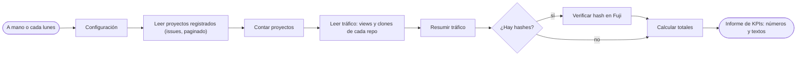

# Reporte de KPIs del evento

Un workflow para quienes organizan: arma el informe de **Nodo Cero – Hackathon n8n Bolivia** con números que cualquiera puede volver a sacar. Cuenta los proyectos registrados por tecnología (Google Cloud incluida), cuántos equipos eligieron cada línea de la hackathon y cuántos se postulan a cada mención especial, trae las visitas y los clones de los repos, verifica en Avalanche Fuji los hashes que informaron los equipos y deja textos listos para mandar a **Team1**, **Supabase** y **Clerk**.



## Qué mide

| KPI | Campo del informe | De dónde sale |
|---|---|---|
| Proyectos registrados | `proyectos` | Issues abiertos con la etiqueta `proyecto` en [`nodo-cero-bo/proyectos`](https://github.com/nodo-cero-bo/proyectos) |
| Proyectos por tecnología | `con_n8n`, `con_ia`, `con_supabase`, `con_clerk`, `con_avalanche_fuji`, `con_google_cloud` | Las casillas «Tecnologías que usaron» del formulario |
| Equipos por línea | `linea_ia`, `linea_web3`, `linea_apps`, `linea_impacto` (y `sin_linea`) | La lista desplegable «Línea»: IA para tu comunidad, Web3 con Avalanche Fuji, Apps con login y datos o Impacto social y ambiental |
| Postulaciones a cada mención especial | `mencion_avalanche_fuji`, `mencion_google_cloud` | Las casillas «¿A qué mención especial se postula tu equipo?»: Mejor uso de Avalanche Fuji y Mejor uso de Google Cloud |
| Core Wallet, Avalanche Academy, Team1 LATAM | `core_wallet`, `avalanche_academy`, `team1_latam` | Las casillas «Ecosistema Avalanche» (lo que declaran los equipos) |
| Equipos que partieron de los workflows de Avalanche | `partieron_de_workflows_avalanche` (y el resto en `partieron_de_workflows`) | La respuesta «¿Partieron de algún workflow del repo?» |
| Hashes de Fuji informados y verificados | `hashes_informados`, `hashes_verificados`, `hashes` | El campo del hash, verificado con `eth_getTransactionReceipt` en el RPC público de Fuji |
| Visitas y clones de los repos | `visitas`, `visitas_unicas`, `clones`, `clones_unicos`, `trafico_por_repo` | La API de tráfico de GitHub: últimos 14 días de `workflows`, `guias`, `proyectos` y `nodo-cero-bo.github.io` |
| Textos para los aliados | `texto_team1`, `texto_supabase`, `texto_clerk`, `texto_general` | Se arman en **Calcular totales** |

Un hash cuenta una vez aunque lo informen dos equipos. Los issues cerrados no cuentan: cerrar un issue es la forma de sacar de la vitrina algo que no era un proyecto. Cada equipo elige una línea, así que las cuatro líneas más `sin_linea` suman el total de proyectos; un equipo puede postularse a las dos menciones, a una o a ninguna. En **Contar proyectos**, la ficha de cada proyecto (`lista`) dice también su línea y sus menciones.

## Qué aprendés

- **HTTP Request** con una credencial de GitHub y **paginación** (pide la página siguiente hasta que llega una vacía).
- A leer el cuerpo de un **formulario de issue de GitHub** con JavaScript: secciones `### <pregunta>`, casillas `- [X] opción` y la opción elegida en una lista desplegable, que llega como texto.
- La **API de tráfico** de GitHub y cómo seguir aunque un repo responda 403 (**Never Error**).
- A verificar varios hashes en **Fuji** por lotes, sin saturar el RPC público.
- A saltear un paso con un **IF** y a correr un workflow cada semana con **Schedule Trigger**.

## Qué necesitás

| Qué | Para qué | Cómo |
|---|---|---|
| Tu n8n | Correr el workflow | Probado en n8n 2.48.7. |
| Credencial **GitHub API** (tipo `githubApi`) | Leer issues y tráfico | En GitHub, **Settings → Developer settings → Personal access tokens**: creá un token fine-grained para la organización `nodo-cero-bo`, con acceso a los cuatro repos y los permisos **Administration** e **Issues** en **Read-only**. En n8n pegalo en **Access Token** (Github Server queda como viene). |
| Permiso de escritura en los repos | La API de tráfico | GitHub muestra el tráfico nada más a quien puede escribir en el repo. Sin ese permiso, el informe marca el repo como «sin acceso» y sigue. |

Elegí la credencial en **Leer proyectos registrados** y en **Leer tráfico**. La verificación en Fuji no pide clave.

## Cómo importarlo

1. **Copiar y pegar**: abrí [`workflow.json`](workflow.json), copiá todo y pegalo con Ctrl+V (Cmd+V en Mac) en un canvas vacío de n8n.
2. **Desde una URL**: en un workflow nuevo, abrí el menú de los tres puntos (arriba a la derecha), elegí **Import** y después **From URL** (en algunas versiones, **Import from URL**), y pegá este enlace:

   ```text
   https://raw.githubusercontent.com/nodo-cero-bo/workflows/main/40-proyectos/42-reporte-kpis/workflow.json
   ```

3. **Archivo**: descargá `workflow.json` y elegí **Import** y después **From file**.

## Cómo probarlo

1. Elegí tu credencial **GitHub API** en los dos nodos que la piden.
2. Revisá **Configuración**: `organizacion` (`nodo-cero-bo`), `repo_proyectos` (`proyectos`), `etiqueta` (`proyecto`) y `repos_trafico` (los repos separados por coma).
3. Tocá **Execute workflow** y abrí **Informe de KPIs**. Copiá el texto de cada aliado y pegalo en tu correo o tu mensaje.
4. Abrí **Contar proyectos** para ver la ficha de cada proyecto (`lista`) y **Resumir tráfico** para ver repo por repo.
5. Para tenerlo cada semana: **Publish**. **Cada lunes a las 9** lo corre sin que lo toques; guardá cada informe, porque GitHub guarda el tráfico nada más 14 días.

Si todavía no hay proyectos registrados, el informe sale en cero y sin hashes: el workflow igual termina bien.

### Si algo no da

| Lo que ves | Qué revisar |
|---|---|
| `Sin acceso al tráfico (HTTP 401)` | Falta la credencial o el token no es válido. |
| `Sin acceso al tráfico (HTTP 403)` o `(HTTP 404)` | El token no tiene acceso a ese repo o le falta el permiso **Administration** (Read-only). |
| Un proyecto no suma en una tecnología | Mirá el issue: la casilla tiene que estar marcada en el formulario. Si cambió un texto del formulario, ajustá las reglas al principio de **Contar proyectos**. |
| Un proyecto suma en `sin_linea` | Se registró antes de que el formulario pidiera la línea (o la respuesta se borró al editar). Pedile al equipo que edite su issue y elija la línea. |
| Un hash figura «no existe en Fuji» | El equipo pegó un hash de otra red o incompleto (tiene que tener 66 caracteres con el `0x`). |

## Cómo lo probamos

En una n8n 2.48.7 local:

- Contra la API real de GitHub, sin token: la lista de issues de `nodo-cero-bo/proyectos` (hoy vacía) y el tráfico, que responde 401 sin credencial. El informe salió en cero, con los cuatro repos «sin acceso» y sin el paso de Fuji.
- Contra una imitación local de la API de GitHub con issues armados como los del formulario (de a dos por página, para probar la paginación, con un pull request, un cuerpo con fines de línea de Windows, un hash repetido y un repo que responde 403): cada número dio lo esperado.
- Los hashes se verificaron en vivo en Fuji: uno que salió bien, uno que falló y uno que no existe.
- Con el formulario nuevo (línea, Google Cloud y menciones): cuerpos armados con los mismos encabezados `### <etiqueta>`, casillas `- [X] opción` y `_No response_` que produce GitHub a partir de `proyecto.yml`, uno por línea, uno con las dos menciones, uno con fines de línea de Windows, uno registrado con el formulario anterior (sin línea), uno cerrado y un pull request. Dio 5 proyectos, 2 con Google Cloud, 1 por línea más 1 `sin_linea`, y 2 postulaciones a cada mención. Con la lista vacía, todo en cero.

Con un token tuyo corre igual; por eso figura como **auditado**.

## Ideas para extenderlo

- **Guardar cada informe**: sumá un nodo de Supabase o de Google Sheets al final para tener la historia semana a semana.
- **Mandarlo por su cuenta**: conectá Gmail o Telegram a **Informe de KPIs** con el texto de cada aliado.
- **Más tráfico**: sumá `/traffic/popular/paths` para ver qué carpetas de workflows se abrieron más.
- **Estrellas y forks**: un pedido a `/repos/{organizacion}/{repo}` trae `stargazers_count` y `forks_count`.

La guía completa para medir cada KPI, con comandos de `gh` y lo que este tráfico no cuenta, está en [KPIS.md](https://github.com/nodo-cero-bo/.github/blob/main/KPIS.md).

## Avalanche Fuji

Los enlaces que comparten los equipos llevan parámetros UTM para que Team1 pueda medir: [Core Wallet](https://core.app/?utm_source=nodo-cero&utm_medium=github&utm_campaign=hackathon-n8n-bolivia-2026), [Avalanche Academy](https://build.avax.network/academy?utm_source=nodo-cero&utm_medium=github&utm_campaign=hackathon-n8n-bolivia-2026), [Team1 LATAM](https://www.team1.network/?utm_source=nodo-cero&utm_medium=github&utm_campaign=hackathon-n8n-bolivia-2026), el [faucet de Fuji](https://build.avax.network/console/primary-network/faucet?utm_source=nodo-cero&utm_medium=github&utm_campaign=hackathon-n8n-bolivia-2026) y el [explorador de Fuji](https://build.avax.network/explorer/fuji/c-chain?utm_source=nodo-cero&utm_medium=github&utm_campaign=hackathon-n8n-bolivia-2026). Lo que llega por esos enlaces lo ve Team1 en su analítica; este informe suma lo que declaran los equipos.

## Documentación oficial

- n8n: [HTTP Request](https://docs.n8n.io/integrations/builtin/core-nodes/n8n-nodes-base.httprequest/), [paginación en HTTP Request](https://docs.n8n.io/code/cookbook/http-node/pagination/), [Code](https://docs.n8n.io/integrations/builtin/core-nodes/n8n-nodes-base.code/), [Schedule Trigger](https://docs.n8n.io/integrations/builtin/core-nodes/n8n-nodes-base.scheduletrigger/) y [credencial de GitHub](https://docs.n8n.io/integrations/builtin/credentials/github/).
- GitHub: [listar los issues de un repo](https://docs.github.com/en/rest/issues/issues#list-repository-issues), [API de tráfico](https://docs.github.com/en/rest/metrics/traffic), [formularios de issues](https://docs.github.com/en/communities/using-templates-to-encourage-useful-issues-and-pull-requests/syntax-for-issue-forms) y [tokens de acceso personal](https://docs.github.com/en/authentication/keeping-your-account-and-data-secure/managing-your-personal-access-tokens).
- Avalanche: [API JSON-RPC de la C-Chain](https://build.avax.network/docs/rpcs/c-chain?utm_source=nodo-cero&utm_medium=github&utm_campaign=hackathon-n8n-bolivia-2026).

## Cuidado con los datos

El informe lleva números y nombres de proyectos o equipos, nunca correos, teléfonos ni datos de contacto. No subas a un repo público los informes con la lista de proyectos sin revisarlos.

---

Licencia MIT, como todo el repo. n8n, GitHub, Supabase, Clerk, Avalanche, Core, Team1 y Google Cloud son marcas de sus dueños.
