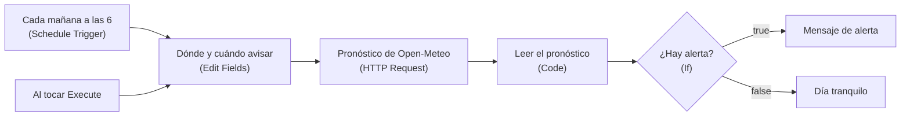

# Alerta del clima en Santa Cruz

**Casos de uso · inicial · 15 minutos · sin credenciales · ejecutado en n8n 2.48.7**

Cada mañana, n8n mira el pronóstico de Santa Cruz de la Sierra y, si viene lluvia fuerte, tormenta, calor extremo o rayos UV extremos, te deja escrito un mensaje de alerta. Es el primer paso de muchos proyectos de la línea **Impacto social y ambiental**: avisos para un barrio, una escuela, una feria al aire libre o una huerta.

No se rompe nada si probás: este workflow lee datos públicos y no le manda nada a nadie.

## Qué hace



1. **Cada mañana a las 6** es un [trigger](https://github.com/nodo-cero-bo/guias/blob/main/glosario.md#trigger) de horario: arranca el workflow solito todos los días, cuando el workflow está [publicado](https://github.com/nodo-cero-bo/guias/blob/main/glosario.md#publicar). **Al tocar Execute** hace lo mismo cuando vos quieras, para probar.
2. **Dónde y cuándo avisar** guarda todo lo que vas a querer cambiar: la ciudad, sus coordenadas y desde qué valor avisar (35 °C de calor, 10 mm de lluvia o 70 % de probabilidad).
3. **Pronóstico de Open-Meteo** le pide el pronóstico de hoy a [Open-Meteo](https://open-meteo.com/), una [API](https://github.com/nodo-cero-bo/guias/blob/main/glosario.md#api) pública y gratis que no pide clave.
4. **Leer el pronóstico** (JavaScript) traduce el código del tiempo a palabras («tormenta eléctrica») y arma la lista de alertas.
5. **¿Hay alerta?** manda el [ítem](https://github.com/nodo-cero-bo/guias/blob/main/glosario.md#item) por arriba si hay alertas y por abajo si no. Cada camino arma su `mensaje`.

## Qué aprendés

- A usar el **Schedule Trigger** y por qué importa la **zona horaria** del workflow.
- A llamar una API con **HTTP Request** y parámetros en la URL (*query parameters*).
- A leer una respuesta con listas (la posición 0 es hoy) en un **Code node**.
- A probar los dos caminos de un **If** con datos simulados, sin esperar a que llueva.
- A respetar las condiciones de uso de una API pública (Open-Meteo pide que la nombres).

## Qué necesitás

Nada más que tu n8n: [n8n Cloud](https://app.n8n.cloud/register) o una instalación en tu compu. No usa [credenciales](https://github.com/nodo-cero-bo/guias/blob/main/glosario.md#credencial).

## Cómo importarlo

1. **Copiar y pegar.** Abrí [`workflow.json`](workflow.json), tocá **Copy raw file**, abrí un workflow nuevo en n8n, hacé clic en el canvas y pegá con Ctrl + V (Cmd + V en Mac). En la [página del evento](https://nodo-cero-bo.github.io) está el botón «Copiar workflow».
2. **Import from URL.** En un workflow nuevo, menú del workflow (los tres puntos, arriba) → **Import from URL**, y pegá:

   ```text
   https://raw.githubusercontent.com/nodo-cero-bo/workflows/main/60-casos-de-uso/60-alerta-del-clima/workflow.json
   ```

3. **Import from File.** Bajá el archivo (**Download raw file**) y elegí **Import from File** en el mismo menú.

Más detalle en la guía [Importar workflows](https://github.com/nodo-cero-bo/guias/blob/main/00-empezar/02-importar-workflows.md).

## Cómo probarlo, paso a paso

1. **Mirá el canvas.** Vas a ver dos disparadores a la izquierda (el reloj y el botón), seis nodos en fila y [notas adhesivas](https://github.com/nodo-cero-bo/guias/blob/main/glosario.md#nota-adhesiva) que explican cada paso. Leé la grande de la izquierda primero.
2. **Ejecutá.** Tocá **Execute workflow**, abajo del canvas. En unos segundos todos los nodos se ponen en verde y aparece un número sobre cada conexión: es la cantidad de ítems que pasaron (1 en todo este workflow).
3. **Mirá la respuesta de la API.** Abrí **Pronóstico de Open-Meteo** con doble clic y elegí la vista **JSON** a la derecha. Vas a ver `daily` con listas: `temperature_2m_max: [29.1]` es la máxima de hoy.
4. **Mirá el pronóstico en palabras.** Abrí **Leer el pronóstico**. Así salió el sábado 21 de noviembre de 2026 a la madrugada:

   ```json
   {
     "ciudad": "Santa Cruz de la Sierra",
     "fecha": "sábado 21 de noviembre",
     "cielo": "tormenta eléctrica",
     "maxima_c": 29.1,
     "minima_c": 23.5,
     "sensacion_maxima_c": 31.4,
     "lluvia_mm": 13.1,
     "probabilidad_lluvia": 71,
     "uv_maximo": 8.85,
     "hay_alerta": true,
     "alertas": [
       "Lluvia: 13.1 mm y 71 % de probabilidad. Llevá paraguas y cuidado con las calles que se inundan.",
       "Tormenta eléctrica: si podés, quedate bajo techo y lejos de árboles aislados."
     ],
     "simulado": false
   }
   ```

5. **Mirá el mensaje.** Si hay alerta, se pone verde **Mensaje de alerta** (si no, **Día tranquilo**). Abrilo: el campo `mensaje` es el texto listo para mandar.
6. **Probá el otro camino.** En **Dónde y cuándo avisar**, cambiá `simular` de `no` a `calor` (o a `lluvia`) y ejecutá de nuevo. El mensaje dice «(Es una prueba: los datos están simulados.)». Volvé a poner `no` cuando termines.
7. **Dejalo andando por su cuenta.** Revisá la zona horaria (menú del workflow → **Settings** → **Timezone** → `America/La_Paz`) y tocá **Publish**. Desde ahí corre todas las mañanas a las 6, y cada corrida queda en la pestaña **Executions**.

## Cómo saber que funcionó

- Todos los nodos en verde y nada más uno de los dos mensajes con un ítem.
- En **Leer el pronóstico**, la `fecha` es la de hoy y los números se parecen a los de cualquier app del clima para Santa Cruz.
- Con el workflow publicado, al otro día a las 6 aparece una ejecución nueva en **Executions** (con el ícono del reloj).

## Si algo falla

| Lo que ves | Qué pasa | Cómo se arregla |
|---|---|---|
| **Pronóstico de Open-Meteo** en rojo con `ENOTFOUND` o `timeout` | Tu n8n no llegó a internet o Open-Meteo tardó. | Probá de nuevo en un minuto. En n8n Cloud casi no pasa; en tu compu, revisá la conexión. |
| Error 400 de Open-Meteo con `reason` | Algún parámetro está mal escrito (por ejemplo un dato de `daily` que no existe). | Leé `reason` en la salida del nodo y compará con la [documentación](https://open-meteo.com/en/docs). |
| Error 429 | Muchos pedidos en poco tiempo. | El plan gratis alcanza de sobra para un pedido por día. Esperá un rato. |
| `fecha: "hoy"` y valores `null` | La respuesta no trajo `daily` (por ejemplo, cambiaste los nombres). | Abrí el nodo HTTP en vista JSON y fijate qué llegó. |
| Corre a una hora rara | La zona horaria del workflow no es la de Bolivia. | **Settings** → **Timezone** → `America/La_Paz`. |
| Nunca corre por su cuenta | El workflow no está publicado. | Tocá **Publish**. Las pruebas con **Execute workflow** no lo dejan programado. |

## Ideas para extenderlo

- **Mandá la alerta al celular**: sumá un nodo **Telegram → Send a text message** después de **Mensaje de alerta**, con `{{ $json.mensaje }}` en el texto. El [workflow 66](../66-bot-de-telegram-con-ia) explica cómo crear el bot.
- **Varias ciudades**: convertí **Dónde y cuándo avisar** en una lista (Montero, Warnes, Cotoca...) y separala en ítems con un **Split Out**: n8n hace un pedido por ciudad.
- **El pronóstico de mañana**: cambiá `forecast_days` a `2` y leé la posición 1 de cada lista.
- **Calidad del aire**: Open-Meteo tiene otra API sin clave para eso ([Air Quality API](https://open-meteo.com/en/docs/air-quality-api)), ideal en época de chaqueos.
- **Guardalo**: registrá cada día en Supabase (como en el [workflow 30](../../30-supabase/30-formulario-a-supabase)) y armá un historial.

## Documentación oficial

- n8n: [Schedule Trigger](https://docs.n8n.io/integrations/builtin/core-nodes/n8n-nodes-base.scheduletrigger/), [HTTP Request](https://docs.n8n.io/integrations/builtin/core-nodes/n8n-nodes-base.httprequest/), [Code](https://docs.n8n.io/integrations/builtin/core-nodes/n8n-nodes-base.code/) e [If](https://docs.n8n.io/integrations/builtin/core-nodes/n8n-nodes-base.if/).
- Open-Meteo: [documentación de la API de pronóstico](https://open-meteo.com/en/docs) y [condiciones de uso](https://open-meteo.com/en/terms) (gratis para uso no comercial, nombrando la fuente).

---

Licencia MIT, como todo el repo. Datos del tiempo de [Open-Meteo.com](https://open-meteo.com/) (CC BY 4.0). n8n y Open-Meteo son marcas de sus dueños.
