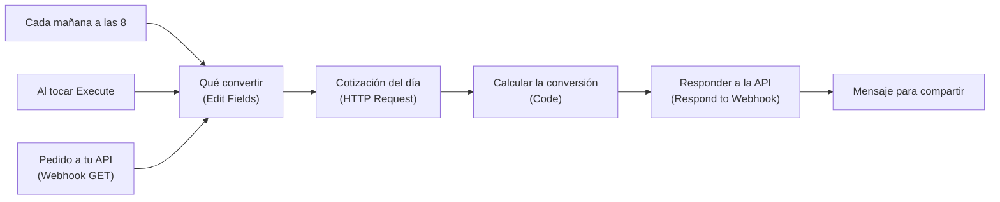

# Tipo de cambio: dólar a bolivianos

**Casos de uso · inicial · 15 minutos · sin credenciales · ejecutado en n8n 2.48.7**

Trae la cotización del día del dólar en bolivianos (y de otras monedas de la región) desde una API pública sin clave, hace la cuenta que le pidas y te la devuelve lista para usar. Además es **tu propia API**: cualquier página o app puede preguntarle «¿cuántos bolivianos son 50 dólares?» con una dirección web.

Sirve para un emprendimiento que vende en dólares, una calculadora para una feria o un aviso diario del cambio.

> Es una **cotización de referencia**, la que publica [ExchangeRate-API](https://www.exchangerate-api.com) a partir de varias fuentes. Para un trámite, un contrato o un banco, mirá la cotización oficial del [Banco Central de Bolivia](https://www.bcb.gob.bo/).

## Qué hace



1. **Tres formas de arrancar**: todos los días a las 8 (cuando está [publicado](https://github.com/nodo-cero-bo/guias/blob/main/glosario.md#publicar)), con el botón **Execute workflow** para probar, o con un pedido a tu [webhook](https://github.com/nodo-cero-bo/guias/blob/main/glosario.md#webhook).
2. **Qué convertir** junta el pedido: `monto`, `de` (moneda de origen) y `a` (moneda de destino). Si el pedido no trae nada, usa 100 USD a BOB.
3. **Cotización del día** le pide a `open.er-api.com/v6/latest/USD` cuánto vale 1 dólar en cada moneda.
4. **Calcular la conversión** revisa el pedido, hace la cuenta y suma referencias del día (euro, real, peso argentino, sol, peso chileno).
5. **Responder a la API** le contesta un [JSON](https://github.com/nodo-cero-bo/guias/blob/main/glosario.md#json) a quien llamó (200 si salió bien, 400 si el pedido estaba mal) y **Mensaje para compartir** deja una frase lista para mandar.

## Qué aprendés

- Que un workflow puede tener **varios disparadores** que llevan al mismo camino.
- Expresiones con **`?.`** y **`??`** para usar un valor por defecto cuando no llega nada.
- A **validar un pedido** y responder con el [código de respuesta](https://github.com/nodo-cero-bo/guias/blob/main/glosario.md#código-de-respuesta) correcto (200 o 400).
- La cuenta para pasar entre dos monedas cualesquiera cuando todas las tasas son contra el dólar.
- A respetar los límites y la atribución de una API pública.

## Qué necesitás

Nada más que tu n8n. No usa credenciales: la API abierta de ExchangeRate-API no pide clave.

Sus reglas (están en su [documentación](https://www.exchangerate-api.com/docs/free)): la cotización se actualiza **una vez por día**, así que no hace falta pedirla más de una vez por hora; si te pasás, responde 429 y te deja esperar 20 minutos. Y pide que la nombres donde uses los datos: «Rates By Exchange Rate API». El workflow ya lo hace en el campo `fuente`.

## Cómo importarlo

1. **Copiar y pegar.** Abrí [`workflow.json`](workflow.json), tocá **Copy raw file** y pegalo con Ctrl + V en un workflow nuevo (o usá «Copiar workflow» en la [página del evento](https://nodo-cero-bo.github.io)).
2. **Import from URL.** Menú del workflow (los tres puntos) → **Import from URL**:

   ```text
   https://raw.githubusercontent.com/nodo-cero-bo/workflows/main/60-casos-de-uso/61-tipo-de-cambio/workflow.json
   ```

3. **Import from File.** Bajá el archivo y elegí **Import from File**.

## Cómo probarlo, paso a paso

1. **Ejecutá.** Tocá **Execute workflow**. Se ponen en verde **Al tocar Execute** y todos los nodos de la fila. Los otros dos disparadores quedan grises: no arrancaron, y está bien.
2. **Mirá la cuenta.** Abrí **Calcular la conversión**. Así salió el 21 de noviembre de 2026:

   ```json
   {
     "ok": true,
     "monto": 100,
     "de": "USD",
     "a": "BOB",
     "resultado": 1172.71,
     "tasa": 11.727068,
     "dolar_en_bolivianos": 11.7271,
     "referencias_en_bolivianos": { "USD": 11.7271, "EUR": 12.8763, "BRL": 1.9899, "ARS": 0.0075, "PEN": 3.4191, "CLP": 0.0116 },
     "cotizacion_del": "19 de noviembre de 2026, 20:02",
     "origen": "prueba",
     "fuente": "Rates By Exchange Rate API (https://www.exchangerate-api.com)"
   }
   ```

   `cotizacion_del` es la hora de Bolivia en que la API actualizó sus datos por última vez (lo hace una vez por día).
3. **Cambiá el pedido.** En **Qué convertir**, las expresiones tienen un valor por defecto a la derecha de `??`: cambiá `'100'` por `'2500'` y `'USD'` por `'EUR'`, y ejecutá de nuevo.
4. **Mirá el mensaje.** Abrí **Mensaje para compartir**: `Cotización del 19 de noviembre de 2026, 20:02: 1 USD = 11.7271 Bs. 100 USD son 1172.71 BOB. Fuente: Rates By Exchange Rate API.`
5. **Probá tu API.** Tocá **Publish**. Abrí **Pedido a tu API** y copiá la **Production URL** (la [URL de producción](https://github.com/nodo-cero-bo/guias/blob/main/glosario.md#url-de-prueba-y-url-de-producción)). Pegala en el navegador y sumale el pedido al final:

   ```text
   https://<tu-n8n>/webhook/tipo-de-cambio?monto=50&de=USD&a=BOB
   ```

   El navegador muestra el JSON con `"resultado": 586.35`. Probá también `?monto=1.000,50&de=BOB&a=USD` (acepta la coma decimal) y `?monto=abc&de=XYZ`: ese responde 400 con `"ok": false` y un mensaje que explica qué está mal.

## Cómo saber que funcionó

- **Calcular la conversión** tiene `"ok": true` y `dolar_en_bolivianos` con un número razonable.
- La URL de producción responde en el navegador con el mismo formato.
- Cada pedido a la API queda en la pestaña **Executions**.

## Si algo falla

| Lo que ves | Qué pasa | Cómo se arregla |
|---|---|---|
| `"ok": false` con «La API de cotizaciones no respondió bien» | ExchangeRate-API devolvió un error. | Probá de nuevo en unos minutos. |
| **Cotización del día** en rojo con código 429 | Demasiados pedidos seguidos (por ejemplo, alguien llamando tu API sin parar). | Esperá 20 minutos. Para una API muy usada, guardá la cotización una vez por hora en Supabase y respondé desde ahí. |
| `"ok": false` con «la moneda no está en la lista» | El código de moneda no existe. | Usá códigos de tres letras: USD, BOB, EUR, BRL, ARS, PEN, CLP. |
| La URL del webhook responde 404 | El workflow no está publicado o usaste la URL de prueba. | Tocá **Publish** y usá la **Production URL**. |
| La URL de prueba (`/webhook-test/...`) no responde | La URL de prueba funciona nada más mientras el editor está escuchando. | Tocá **Listen for test event** en el Webhook, o usá la de producción. |

## Ideas para extenderlo

- **Un aviso diario**: después de **Mensaje para compartir**, un nodo **Telegram** que mande `{{ $json.mensaje }}` a tu grupo cada mañana (el [workflow 66](../66-bot-de-telegram-con-ia) explica cómo crear el bot).
- **Avisar si cambia mucho**: guardá la cotización de ayer con `$getWorkflowStaticData('global')` (como en el [workflow 14](../../10-avalanche-fuji/14-fuji-monitor-wallet)) y avisá si se movió más de un 1 %.
- **Una calculadora con formulario**: cambiá el Webhook por un **n8n Form Trigger** con los campos monto, de y a, y mostrá el resultado en la página final (como en el [workflow 04](../../00-fundamentos/04-formulario)).
- **Precios en bolivianos**: usala junto al [workflow 63](../63-leer-una-pagina-web) para pasar precios de libras a bolivianos (`de=GBP&a=BOB`).

## Documentación oficial

- n8n: [Webhook](https://docs.n8n.io/integrations/builtin/core-nodes/n8n-nodes-base.webhook/), [Respond to Webhook](https://docs.n8n.io/integrations/builtin/core-nodes/n8n-nodes-base.respondtowebhook/), [Schedule Trigger](https://docs.n8n.io/integrations/builtin/core-nodes/n8n-nodes-base.scheduletrigger/), [HTTP Request](https://docs.n8n.io/integrations/builtin/core-nodes/n8n-nodes-base.httprequest/) y [Code](https://docs.n8n.io/integrations/builtin/core-nodes/n8n-nodes-base.code/).
- ExchangeRate-API: [la API abierta, sus límites y la atribución](https://www.exchangerate-api.com/docs/free).
- [Banco Central de Bolivia](https://www.bcb.gob.bo/), para la cotización oficial.

---

Licencia MIT, como todo el repo. Rates By [Exchange Rate API](https://www.exchangerate-api.com). n8n y ExchangeRate-API son marcas de sus dueños.
