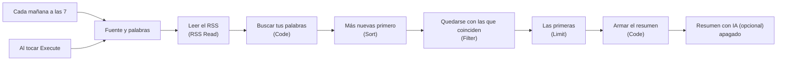

# Noticias por RSS: tu resumen del día

**Casos de uso · inicial · 15 minutos · sin credenciales (la IA es opcional) · ejecutado en n8n 2.48.7**

Lee las noticias en español de [Noticias ONU](https://news.un.org/es/) por RSS, se queda con las que hablan de lo que te importa (clima, agua, Bolivia, mujeres, educación, salud...) y arma un resumen con enlaces, listo para mandar a tu grupo cada mañana. Si tenés una clave de Gemini, una IA puede escribirte además un párrafo con lo más importante.

No se rompe nada si probás: el workflow lee y ordena, no publica nada.

## Qué es un RSS

Un **RSS** (o *feed*) es la lista de las últimas notas de un sitio, en un formato pensado para que lo lean los programas (XML). Muchos diarios, blogs y organismos tienen uno: buscá «RSS» o el ícono naranja al pie de su página. Con n8n lo leés como si fuera una API, sin clave.

## Qué hace



1. **Fuente y palabras** tiene el enlace del RSS, tu lista de palabras clave, cuántos días hacia atrás mirar (`dias`: 7) y cuántas noticias querés (`maximo`: 5).
2. **Leer el RSS** devuelve **un [ítem](https://github.com/nodo-cero-bo/guias/blob/main/glosario.md#item) por noticia** (30 en el de Noticias ONU).
3. **Buscar tus palabras** compara sin mayúsculas ni tildes y busca **palabras enteras** (así «agua» no aparece dentro de «paraguas»). Marca `coincidencias` y `reciente`.
4. **Más nuevas primero**, **Quedarse con las que coinciden** y **Las primeras** ordenan por fecha, filtran y cortan la lista, sin código. El orden importa: si el filtro no deja pasar nada, sale un ítem vacío, y un Sort después de él fallaría porque ese ítem no tiene fecha.
5. **Armar el resumen** junta todo en un texto con viñetas y enlaces.
6. **Resumen con IA (opcional)** viene **apagado**: prendelo si querés que Gemini escriba un párrafo.

## Qué aprendés

- A leer un RSS con el nodo **RSS Read**.
- A buscar palabras enteras sin importar mayúsculas ni tildes, en un **Code node**.
- **Filter**, **Sort** y **Limit**: tres nodos que resuelven sin código lo que más se usa con listas.
- **Always Output Data**: para que el workflow siga aunque el filtro no deje pasar nada (y te avise «hoy no hubo noticias»).
- A **prender y apagar nodos** (tecla **D**) para tener partes opcionales.

## Qué necesitás

- Tu n8n. Para la parte básica no hace falta ninguna credencial.
- Opcional, para el resumen con IA: la credencial **Google Gemini(PaLM) Api** (`googlePalmApi`), con una clave gratis de [Google AI Studio](https://aistudio.google.com/). Paso a paso en la guía [Clave de Gemini](https://github.com/nodo-cero-bo/guias/blob/main/00-empezar/07-clave-gemini.md).

## Cómo importarlo

1. **Copiar y pegar.** Abrí [`workflow.json`](workflow.json), tocá **Copy raw file** y pegalo con Ctrl + V en un workflow nuevo (o «Copiar workflow» en la [página del evento](https://nodo-cero-bo.github.io)).
2. **Import from URL.** Menú del workflow (los tres puntos) → **Import from URL**:

   ```text
   https://raw.githubusercontent.com/nodo-cero-bo/workflows/main/60-casos-de-uso/62-noticias-rss/workflow.json
   ```

3. **Import from File.** Bajá el archivo y elegí **Import from File**.

## Cómo probarlo, paso a paso

1. **Ejecutá.** Tocá **Execute workflow**. Fijate los números sobre las conexiones: 30 noticias salen de **Leer el RSS**, unas pocas pasan el filtro y 5 llegan al resumen.
2. **Mirá cada noticia.** Abrí **Buscar tus palabras** en la vista **Table**: cada fila es una noticia, con `coincidencias` (qué palabras encontró) y `reciente`.
3. **Mirá el resumen.** Abrí **Armar el resumen** y leé el campo `texto`. Así salió el 21 de noviembre de 2026:

   ```text
   Resumen del sábado 21 de noviembre: 5 noticias que te pueden interesar.

   - COP31: 21 asuntos sin resolver a tres días del final (18 de noviembre). Habla de: clima.
     https://news.un.org/feed/view/es/story/2026/11/1542190
   - Alerta: Los antibióticos están dejando de funcionar contra infecciones comunes (18 de noviembre). Habla de: salud.
     https://news.un.org/feed/view/es/story/2026/11/1542187
   - Bolivia, Estados Unidos y México pierden su estatus de países libres del sarampión (17 de noviembre). Habla de: bolivia, salud.
     https://news.un.org/feed/view/es/story/2026/11/1542184
   ...
   Fuente: Noticias ONU.
   ```

4. **Cambiá las palabras.** En **Fuente y palabras**, editá `palabras` (es una lista: `["clima", "agua", ...]`), por ejemplo sumá `"ciencia"`, y ejecutá de nuevo.
5. **Probá con nada.** Poné una palabra que no aparezca (`"dinosaurio"`) y ejecutá: el resumen dice «hoy no hubo noticias recientes con tus palabras». Eso es **Always Output Data** del Filter.
6. **Opcional, la IA.** Abrí **Modelo Gemini**, creá la credencial con tu clave, seleccioná **Resumen con IA (opcional)** y **Modelo Gemini** y prendelos con la tecla **D**. Ejecutá: en la salida del nodo de IA aparece `text` con un párrafo corto.
7. **Cada mañana.** Revisá **Settings** → **Timezone** (`America/La_Paz`) y tocá **Publish**: corre todos los días a las 7.

## Cómo saber que funcionó

- **Leer el RSS** tiene alrededor de 30 ítems con `title`, `link` e `isoDate`.
- **Armar el resumen** tiene un ítem con `cantidad` y `texto`.
- Con la IA prendida, **Resumen con IA (opcional)** devuelve `text` en español.

## Si algo falla

| Lo que ves | Qué pasa | Cómo se arregla |
|---|---|---|
| **Leer el RSS** en rojo: «Non-whitespace before first tag» o «Invalid XML» | El enlace no es un RSS (es una página común). | Buscá el enlace que termina en `.xml`, `/rss` o `/feed` y probalo en el navegador. |
| **Leer el RSS** con error 403 o 404 | El sitio cambió el enlace o no deja leerlo. | Probá otro RSS. Respetá las condiciones del sitio. |
| El resumen dice que no hubo noticias | Ninguna noticia de los últimos `dias` tiene tus palabras. | Sumá palabras o subí `dias`. |
| `Las primeras` deja pasar todo | `maximo` está vacío o no es número. | Poné un número en `maximo`. |
| **Resumen con IA** en rojo: «Credentials not found» | Prendiste el nodo pero falta la credencial. | Elegí la credencial en **Modelo Gemini**. |
| Error 429 o «quota» de Gemini | Te pasaste del límite gratis por minuto. | Esperá un minuto; un pedido por día está lejísimos del límite. |

## Ideas para extenderlo

- **Mandalo por Telegram o Gmail** cada mañana con `{{ $json.texto }}` (mirá el [workflow 60](../60-alerta-del-clima) y el [66](../66-bot-de-telegram-con-ia)).
- **Varias fuentes**: varios nodos **RSS Read** juntados con un **Merge** antes de buscar las palabras.
- **Sin repetidos entre días**: un **Remove Duplicates** con **Remove Items Processed in Previous Executions** por el campo `enlace`, para no mandar dos veces la misma noticia.
- **Clasificar con IA** en vez de palabras: pasá cada noticia por el [workflow 65](../65-clasificar-mensajes-con-ia).

## Documentación oficial

- n8n: [RSS Read](https://docs.n8n.io/integrations/builtin/core-nodes/n8n-nodes-base.rssfeedread/), [Filter](https://docs.n8n.io/integrations/builtin/core-nodes/n8n-nodes-base.filter/), [Sort](https://docs.n8n.io/integrations/builtin/core-nodes/n8n-nodes-base.sort/), [Limit](https://docs.n8n.io/integrations/builtin/core-nodes/n8n-nodes-base.limit/), [Code](https://docs.n8n.io/integrations/builtin/core-nodes/n8n-nodes-base.code/) y [Basic LLM Chain](https://docs.n8n.io/integrations/builtin/cluster-nodes/root-nodes/n8n-nodes-langchain.chainllm/).
- [Noticias ONU en español](https://news.un.org/es/), la fuente del ejemplo.

---

Licencia MIT, como todo el repo. Las noticias son de Noticias ONU y cada enlace lleva a la nota original. n8n y Google Gemini son marcas de sus dueños.
