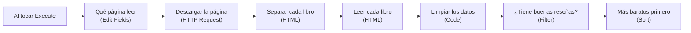

# Leer una página web

**Casos de uso · intermedio · 20 minutos · sin credenciales · ejecutado en n8n 2.48.7**

Muchos datos útiles no tienen API: están en una página web. Este workflow descarga una página, encuentra cada producto con **selectores CSS** y te deja una tabla limpia con título, precio, estrellas y enlace. A esto se le dice *web scraping* (extraer datos de una página).

La práctica es con [books.toscrape.com](https://books.toscrape.com/), una librería de mentira hecha para aprender: sus precios y reseñas son inventados y el sitio [toscrape.com](https://toscrape.com/) la presenta como un lugar seguro para que principiantes practiquen. No se rompe nada si probás.

## Antes de leer cualquier página

Que una página se pueda ver no quiere decir que se pueda copiar. Antes de apuntar este workflow a otro sitio:

1. **Mirá su `robots.txt`**: abrí `https://el-sitio.com/robots.txt`. Es un archivo donde el sitio dice qué partes no quiere que lean los programas (`Disallow`). Si la parte que te interesa está prohibida, no la leas. books.toscrape.com no tiene `robots.txt` (responde 404): no pone reglas.
2. **Leé sus términos de uso**: muchos prohíben copiar sus datos. Si el sitio tiene una API oficial o datos abiertos, usalos: son más estables y están permitidos.
3. **Andá despacio**: una página cada tanto, nunca cientos por minuto. Un workflow apurado puede tirar un sitio chico.
4. **Nada de datos personales**: no juntes nombres, teléfonos ni correos de personas.

## Qué hace



1. **Qué página leer**: la dirección (`url`) y desde cuántas estrellas te interesa un libro (`estrellas_minimas`: 4).
2. **Descargar la página**: un [pedido HTTP](https://github.com/nodo-cero-bo/guias/blob/main/glosario.md#pedido-http) GET con **Response Format: Text**. La página entera queda como texto en el campo `html`.
3. **Separar cada libro**: el nodo **HTML** busca el selector `article.product_pod` (cada tarjeta de libro) y devuelve una lista con el HTML de cada una. También lee `li.next a` para saber dónde sigue la lista.
4. **Leer cada libro**: el mismo nodo, pero ahora recibe esa lista y devuelve **un [ítem](https://github.com/nodo-cero-bo/guias/blob/main/glosario.md#item) por libro**, con su título, precio, estrellas, disponibilidad y enlace.
5. **Limpiar los datos** (JavaScript) pasa los textos a números: `£51.77` → `51.77`, `star-rating Three` → `3`, y arma el enlace completo.
6. **¿Tiene buenas reseñas?** se queda con los de 4 estrellas o más y **Más baratos primero** los ordena por precio.

## Qué es un selector CSS

Un **selector CSS** es la forma de señalar una parte de una página. Los mismos que usa el diseño de una web sirven para encontrar datos:

| selector | qué encuentra |
|---|---|
| `article.product_pod` | cada etiqueta `<article>` con la clase `product_pod` |
| `h3 a` | un enlace `<a>` que está adentro de un título `<h3>` |
| `p.price_color` | el párrafo con la clase `price_color` (el precio) |
| `li.next a` | el enlace adentro del `<li>` con la clase `next` |

Para encontrar el tuyo: en Chrome o Firefox, clic derecho sobre el dato → **Inspeccionar**. Se abre el código de la página con la etiqueta marcada: mirá su nombre y su `class`.

En el nodo HTML, cada dato tiene un **Return Value**: **Text** (lo que se lee), **HTML** (el código de adentro) o **Attribute** (un dato escondido en la etiqueta, como `title`, `href` o `class`). El título completo del libro está en el atributo `title` del enlace: el texto que se ve viene cortado con «...».

## Qué aprendés

- A descargar el HTML de una página con **HTTP Request**.
- A usar el nodo **HTML** en dos pasos: primero cada tarjeta, después lo de adentro de cada una.
- La diferencia entre leer el texto, el HTML o un atributo de una etiqueta.
- A pasar textos a números para poder filtrar y ordenar.
- A revisar `robots.txt` y los términos de uso antes de leer un sitio.

## Qué necesitás

Nada más que tu n8n. No usa credenciales.

## Cómo importarlo

1. **Copiar y pegar.** Abrí [`workflow.json`](workflow.json), tocá **Copy raw file** y pegalo con Ctrl + V en un workflow nuevo (o «Copiar workflow» en la [página del evento](https://nodo-cero-bo.github.io)).
2. **Import from URL.** Menú del workflow (los tres puntos) → **Import from URL**:

   ```text
   https://raw.githubusercontent.com/nodo-cero-bo/workflows/main/60-casos-de-uso/63-leer-una-pagina-web/workflow.json
   ```

3. **Import from File.** Bajá el archivo y elegí **Import from File**.

## Cómo probarlo, paso a paso

1. **Ejecutá.** Tocá **Execute workflow**. Fijate los números sobre las conexiones: 1 ítem hasta **Separar cada libro**, 20 después de **Leer cada libro** (los 20 libros de la página) y 8 después del filtro.
2. **Mirá la página cruda.** Abrí **Descargar la página**: el campo `html` es un texto larguísimo. Eso es lo que ve n8n.
3. **Mirá las tarjetas.** Abrí **Separar cada libro**: `libros` es una lista de 20 pedazos de HTML y `pagina_siguiente` vale `catalogue/page-2.html`.
4. **Mirá cada libro.** Abrí **Leer cada libro** en la vista **Table**: 20 filas con `titulo`, `precio` (`£51.77`), `estrellas` (`star-rating Three`), `disponibilidad` y `enlace`.
5. **Mirá el resultado.** Abrí **Más baratos primero** en la vista **Table**. El 21 de noviembre de 2026 salieron 8 libros, el primero así:

   ```json
   {
     "titulo": "Set Me Free",
     "precio_libras": 17.46,
     "estrellas": 5,
     "disponible": true,
     "enlace": "https://books.toscrape.com/catalogue/set-me-free_988/index.html"
   }
   ```

6. **Cambiá el filtro.** En **Qué página leer**, poné `estrellas_minimas` en `1` (pasan los 20) o en `5` (pasan menos) y ejecutá de nuevo.
7. **Otra página del catálogo.** Cambiá `url` por `https://books.toscrape.com/catalogue/page-2.html` y ejecutá: son otros 20 libros, con los mismos selectores.

## Cómo saber que funcionó

- **Leer cada libro** tiene 20 ítems y ninguno con campos vacíos.
- **Limpiar los datos** tiene `precio_libras` como número (sin `£`) y `estrellas` entre 1 y 5.
- **Más baratos primero** está ordenado del precio más bajo al más alto.

## Si algo falla

| Lo que ves | Qué pasa | Cómo se arregla |
|---|---|---|
| **Separar cada libro** devuelve `libros: []` | El selector no encontró nada: la página cambió o el selector está mal escrito. | Inspeccioná la página de nuevo y copiá la clase exacta (con mayúsculas y guiones). |
| **Leer cada libro** en rojo: «No property named "libros" exists» | El paso anterior no dejó el campo `libros`. | Revisá el **Key** del primer HTML: tiene que ser `libros`. |
| Los textos vienen con enlaces entre corchetes, como `Beni [https://...]` | En el nodo HTML 1.2, **Text** escribe también la dirección de los enlaces que hay adentro. | Apuntá el selector al enlace mismo (`td a`) o usá **Attribute** con `title`. |
| `precio_libras` es `0` o `NaN` | El precio tenía otro formato (por ejemplo `1.234,50`). | Ajustá la limpieza en el Code para ese formato. |
| **Descargar la página** con error 403 | El sitio rechaza a los programas. | Respetalo: no insistas. Buscá si tiene API o datos abiertos. |
| La página se ve en el navegador pero `html` viene casi vacío | El sitio arma el contenido con JavaScript en el navegador; HTTP Request trae nada más el HTML inicial. | Buscá la API que usa la página (pestaña **Red** del navegador) o elegí otra fuente. |

## Ideas para extenderlo

- **Leer varias páginas**: un Code que arme las 50 direcciones (`page-1.html` a `page-50.html`) antes de **Descargar la página**. Agregá un **Wait** de unos segundos entre pedidos para ir despacio.
- **Precios en bolivianos**: pasá `precio_libras` por la cotización del [workflow 61](../61-tipo-de-cambio) con `de=GBP&a=BOB`.
- **Vigilar un precio**: un **Schedule Trigger** que lea la página cada día y avise si un precio bajó (como el monitor del [workflow 14](../../10-avalanche-fuji/14-fuji-monitor-wallet)).
- **Guardar en Supabase** cada lectura para tener un historial ([workflow 30](../../30-supabase/30-formulario-a-supabase)).

## Documentación oficial

- n8n: [HTML](https://docs.n8n.io/integrations/builtin/core-nodes/n8n-nodes-base.html/), [HTTP Request](https://docs.n8n.io/integrations/builtin/core-nodes/n8n-nodes-base.httprequest/), [Filter](https://docs.n8n.io/integrations/builtin/core-nodes/n8n-nodes-base.filter/) y [Sort](https://docs.n8n.io/integrations/builtin/core-nodes/n8n-nodes-base.sort/).
- [Selectores CSS en MDN](https://developer.mozilla.org/es/docs/Web/CSS/CSS_selectors), en español.
- [Qué es robots.txt](https://developers.google.com/search/docs/crawling-indexing/robots/intro?hl=es), en la documentación de Google.

---

Licencia MIT, como todo el repo. books.toscrape.com es un sitio de práctica (toscrape.com) y sus datos son ficticios. n8n es una marca de su dueño.
