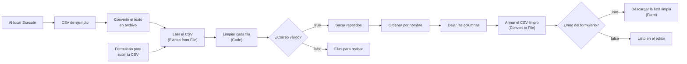

# Limpiar una lista (CSV)

**Casos de uso · inicial · 20 minutos · sin credenciales · ejecutado en n8n 2.48.7**

Las listas reales vienen desordenadas: nombres en mayúsculas, espacios de más, la misma persona anotada dos veces, correos mal escritos, ciudades escritas de cinco formas. Este workflow toma un CSV así, lo limpia y te devuelve uno prolijo, ordenado y sin repetidos. Las filas con problemas quedan aparte, con el motivo, para que las revises a mano.

Además trae un **formulario**: subís tu CSV y te bajás el limpio, sin abrir n8n. Sirve para listas de inscripción, de voluntariado, de clientas de un emprendimiento o de una feria.

No se rompe nada si probás: el archivo original no se toca.

## Qué es un CSV

Un **CSV** es una tabla guardada como texto: cada línea es una fila y los valores van separados por comas. La primera línea es el encabezado (los nombres de las columnas). Excel, Google Sheets y casi cualquier sistema exportan e importan CSV (**Archivo → Descargar → CSV**, o **Guardar como → CSV**).

```text
Nombre,Correo,Equipo,Ciudad
Ana Flores,ana.flores@example.com,Equipo Tajibo,Santa Cruz de la Sierra
```

## Qué hace



1. **CSV de ejemplo** tiene una lista inventada con todos los problemas típicos. **Convertir el texto en archivo** la vuelve un archivo, igual al que llega por el formulario.
2. **Leer el CSV** (**Extract from File**) devuelve **un [ítem](https://github.com/nodo-cero-bo/guias/blob/main/glosario.md#item) por fila**.
3. **Limpiar cada fila** (JavaScript) encuentra las columnas aunque el encabezado diga `E-mail` o `Nombre completo`, escribe los nombres como nombres propios, pasa los correos a minúsculas, unifica las ciudades (`SCZ`, `sta. cruz` → `Santa Cruz de la Sierra`), saltea las filas vacías y marca lo que está mal.
4. **¿Correo válido?** separa: las filas buenas siguen; las que tienen problemas van a **Filas para revisar**.
5. **Sacar repetidos** (por `correo`), **Ordenar por nombre** y **Dejar las columnas** preparan la lista, sin código.
6. **Armar el CSV limpio** (**Convert to File**) crea `lista_limpia.csv`. Si la lista vino del formulario, **Descargar la lista limpia** se la devuelve a la persona.

## Qué aprendés

- A leer un archivo CSV (**Extract from File**) y a crear uno (**Convert to File**).
- Qué es un **binario** en n8n: un archivo que viaja con el ítem, al lado de sus datos.
- A limpiar textos en un **Code node**: espacios, mayúsculas, tildes y equivalencias.
- A revisar la **forma** de un correo (y por qué eso no prueba que el correo exista).
- **Remove Duplicates** y **Sort**, sin código.
- Un formulario que **recibe un archivo y devuelve otro**.

## Qué necesitás

Nada más que tu n8n. No usa credenciales ni guarda la lista en ninguna base: queda nada más en el historial de ejecuciones (**Executions**) de tu n8n.

## Cómo importarlo

1. **Copiar y pegar.** Abrí [`workflow.json`](workflow.json), tocá **Copy raw file** y pegalo con Ctrl + V en un workflow nuevo (o «Copiar workflow» en la [página del evento](https://nodo-cero-bo.github.io)).
2. **Import from URL.** Menú del workflow (los tres puntos) → **Import from URL**:

   ```text
   https://raw.githubusercontent.com/nodo-cero-bo/workflows/main/60-casos-de-uso/64-limpiar-una-lista/workflow.json
   ```

3. **Import from File.** Bajá el archivo y elegí **Import from File**.

## Cómo probarlo, paso a paso

1. **Mirá la lista desordenada.** Abrí **CSV de ejemplo**: 9 filas con nombres en mayúsculas, un correo repetido (`ANA.FLORES@EXAMPLE.COM` y `ana.flores@example.com `), un correo con `(arroba)`, otro sin `.com`, una fila vacía y una sin correo. Las personas son inventadas y los correos usan `example.com`, un dominio reservado para ejemplos.
2. **Ejecutá.** Tocá **Execute workflow**. Seguí los números sobre las conexiones: 9 filas salen de **Leer el CSV**, 8 de **Limpiar cada fila** (saltea la vacía), 5 van por **true** y 3 por **false**, y 4 quedan después de **Sacar repetidos**.
3. **Mirá la lista limpia.** Abrí **Dejar las columnas** en la vista **Table**:

   | nombre | correo | equipo | ciudad |
   |---|---|---|---|
   | Ana Flores | ana.flores@example.com | Equipo Tajibo | Santa Cruz de la Sierra |
   | María José Rojas | mariajose.rojas@example.com | Equipo Motacú | Santa Cruz de la Sierra |
   | Rosa Áñez | rosa.anez@example.com | Equipo Cusi | La Guardia |
   | Valeria Justiniano | valeria.justiniano@example.com | Equipo Cusi | Santa Cruz de la Sierra |

4. **Bajá el archivo.** Abrí **Armar el CSV limpio**: a la derecha, en la pestaña **Binary**, está `lista_limpia.csv`. Tocá **Download** y abrilo con Excel o Google Sheets.
5. **Mirá lo que hay que revisar.** Abrí **Filas para revisar**: Lucía Vaca Díez y Carla Suárez tienen un correo sin forma de correo, y a Daniela Ortiz le falta el correo. Cada fila dice su `problema`.
6. **Con tu propia lista.** Tocá **Publish**, abrí **Formulario para subir tu CSV** y copiá la **Production URL**. Abrila en el navegador: vas a ver el formulario «Limpiá tu lista» con los colores de Nodo Cero. Subí tu CSV y tocá **Limpiar mi lista**: la página dice cuántas filas quedaron limpias y cuántas para revisar, y el navegador baja `lista_limpia.csv`.

El CSV limpio sale con BOM, una marca invisible al principio que hace que Excel muestre bien las tildes y las eñes.

## Cómo saber que funcionó

- **Dejar las columnas** tiene 4 filas, en orden alfabético, sin mayúsculas raras ni espacios de más.
- **Filas para revisar** tiene 3 filas, cada una con su `problema`.
- Con el formulario, el navegador baja un archivo `lista_limpia.csv` con las columnas `nombre,correo,equipo,ciudad`.

## Si algo falla

| Lo que ves | Qué pasa | Cómo se arregla |
|---|---|---|
| Todas las filas llegan en una sola columna, con `;` adentro | Tu Excel guardó el CSV con punto y coma (pasa con la configuración en español). | En **Leer el CSV** → **Options** → **Delimiter**, poné `;`. |
| Las tildes se ven como `é` | El archivo no está en UTF-8. | En **Leer el CSV** → **Options** → **Encoding**, probá `latin1`. O exportalo de nuevo como «CSV UTF-8». |
| Todas las filas van a **Filas para revisar** con «falta el correo» | El encabezado de la columna no se parece a ninguno conocido. | Agregá tu nombre de columna (en minúsculas y sin tildes) a la lista `COLUMNAS` del Code. |
| **Leer el CSV** en rojo: «This operation expects the node's input data to contain a binary file» | El archivo no llegó en el binario `archivo`. | En el formulario, el **Field Name** del campo tiene que ser `archivo`. |
| La ejecución se queda en «Waiting» | Llegaste a un nodo **n8n Form** sin un formulario abierto del otro lado. | No saques el IF **¿Vino del formulario?**: está para eso. |
| Una persona real quedó afuera por «repetida» | Dos personas comparten el mismo correo (pasa con correos de una familia o de una oficina). | Cambiá **Sacar repetidos** para comparar `correo` y `nombre` (**Fields To Compare**: `correo, nombre`). |

## Ideas para extenderlo

- **Mandá las filas para revisar** a quien organiza, por Telegram o Gmail.
- **Guardá la lista limpia en Supabase** en vez de devolver un archivo (como en el [workflow 30](../../30-supabase/30-formulario-a-supabase)).
- **Invitaciones**: pasá los correos limpios al [workflow 22](../../20-clerk/22-clerk-invitaciones) para invitar a cada persona con Clerk.
- **Más reglas**: teléfonos con el mismo formato, fechas en `dd/mm/aaaa`, equipos de hasta 4 personas.
- **Excel**: **Extract from File** y **Convert to File** también leen y escriben `.xlsx`; cambiá la operación.

## Documentación oficial

- n8n: [Extract from File](https://docs.n8n.io/integrations/builtin/core-nodes/n8n-nodes-base.extractfromfile/), [Convert to File](https://docs.n8n.io/integrations/builtin/core-nodes/n8n-nodes-base.converttofile/), [Remove Duplicates](https://docs.n8n.io/integrations/builtin/core-nodes/n8n-nodes-base.removeduplicates/), [Sort](https://docs.n8n.io/integrations/builtin/core-nodes/n8n-nodes-base.sort/), [n8n Form Trigger](https://docs.n8n.io/integrations/builtin/core-nodes/n8n-nodes-base.formtrigger/) y [n8n Form](https://docs.n8n.io/integrations/builtin/core-nodes/n8n-nodes-base.form/).
- [Trabajar con archivos (binarios) en n8n](https://docs.n8n.io/build/work-with-data/handle-special-data-types/work-with-files-and-images).

---

Licencia MIT, como todo el repo. Los datos de ejemplo son inventados. n8n es una marca de su dueño.
