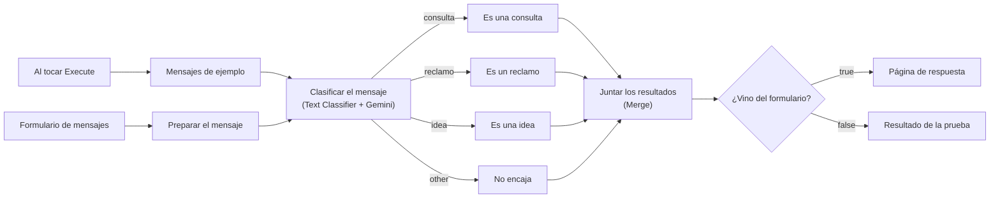

# Clasificar mensajes con IA

**Casos de uso · inicial · 20 minutos · credencial: Google Gemini (clave gratis) · auditado en n8n 2.48.7**

Llega un mensaje (por un formulario, un correo o un chat) y la IA decide si es una **consulta**, un **reclamo** o una **idea**. Cada tipo sale por su propio camino, con su prioridad y su próximo paso, y la persona que escribió recibe una respuesta acorde. Sirve para ordenar lo que le escriben a una organización, a un emprendimiento o a una junta vecinal, sin leer todo a mano.

No se rompe nada si probás: los mensajes de ejemplo son inventados y nada se guarda.

## Qué es clasificar con IA

[Clasificar](https://github.com/nodo-cero-bo/guias/blob/main/glosario.md#clasificar) es elegir una etiqueta para cada cosa. Un [LLM](https://github.com/nodo-cero-bo/guias/blob/main/glosario.md#llm) como Gemini lo hace bien porque entiende el sentido del texto, no nada más las palabras: «hace dos semanas que no pasa el camión» es un reclamo aunque no diga «reclamo».

El nodo **Text Classifier** de n8n le pasa a la IA el texto y tus categorías con su descripción, y tiene **una salida por categoría**: es como un **Switch**, pero que entiende lo que lee.

## Qué hace



1. **Mensajes de ejemplo** arma 6 mensajes inventados; **Formulario de mensajes** recibe uno de verdad. Las dos ramas dejan el ítem con `mensaje` y `origen`.
2. **Clasificar el mensaje** le pregunta a Gemini qué es cada mensaje. La **descripción** de cada categoría es lo que más pesa: cuanto más clara, mejor clasifica.
3. **Es una consulta**, **Es un reclamo**, **Es una idea** y **No encaja** (la salida *Other*, para lo que no es ninguna) suman `categoria`, `prioridad` y la `respuesta` para la persona.
4. **Juntar los resultados** (**Merge**, modo **Append**, 4 entradas) vuelve a juntar los caminos.
5. Si vino del formulario, **Página de respuesta** le muestra a la persona su respuesta. Si vino de los ejemplos, termina en **Resultado de la prueba**.

## Qué aprendés

- **Text Classifier**: categorías con descripción y una salida para cada una.
- La salida **Other** (*When No Clear Match → Output on Extra, 'Other' Branch*) para lo que no encaja.
- A conectar un **modelo** (Google Gemini Chat Model) a un nodo de IA.
- Por qué conviene la **temperatura 0** para clasificar: la misma pregunta, la misma respuesta.
- **Merge** en modo **Append** para volver a juntar caminos.

## Qué necesitás

- Tu n8n.
- La credencial **Google Gemini(PaLM) Api** (`googlePalmApi`): una clave gratis de [Google AI Studio](https://aistudio.google.com/) (**Get API key** → **Create API key**). Paso a paso en la guía [Clave de Gemini](https://github.com/nodo-cero-bo/guias/blob/main/00-empezar/07-clave-gemini.md). En n8n: **Credentials** → **Add credential** → «Google Gemini(PaLM) Api» → pegá la clave en **API Key** (el **Host** dejalo como viene).

La clave es tuya: no la pegues en notas, capturas ni en el repo. n8n la guarda cifrada en la credencial. El modelo elegido es `models/gemini-3.5-flash-lite`, el mismo del [workflow 05](../../00-fundamentos/05-agente-ia), con nivel gratuito.

¿Preferís OpenAI? Cambiá **Modelo Gemini** por **OpenAI Chat Model** (credencial `openAiApi`); el resto queda igual.

## Cómo importarlo

1. **Copiar y pegar.** Abrí [`workflow.json`](workflow.json), tocá **Copy raw file** y pegalo con Ctrl + V en un workflow nuevo (o «Copiar workflow» en la [página del evento](https://nodo-cero-bo.github.io)).
2. **Import from URL.** Menú del workflow (los tres puntos) → **Import from URL**:

   ```text
   https://raw.githubusercontent.com/nodo-cero-bo/workflows/main/60-casos-de-uso/65-clasificar-mensajes-con-ia/workflow.json
   ```

3. **Import from File.** Bajá el archivo y elegí **Import from File**.

## Cómo probarlo, paso a paso

1. **Cargá la credencial.** **Modelo Gemini** tiene un triángulo de advertencia: abrilo con doble clic y, en **Credential to connect with**, elegí o creá tu credencial **Google Gemini(PaLM) Api**. El triángulo desaparece.
2. **Ejecutá.** Tocá **Execute workflow**. **Clasificar el mensaje** tarda unos segundos (hace un pedido a Gemini por mensaje). Después fijate los números sobre cada salida: con los 6 ejemplos, lo esperable es 2 por **consulta**, 2 por **reclamo**, 2 por **idea** y 0 por **No encaja**.
3. **Mirá el resultado.** Abrí **Resultado de la prueba** en la vista **Table**: cada mensaje con su `categoria`, su `prioridad` y su `respuesta`. Por ejemplo:

   | mensaje | categoria | prioridad |
   |---|---|---|
   | ¿A qué hora abren el punto de reciclaje del barrio el sábado? | consulta | normal |
   | Hace dos semanas que no pasa el camión de la basura por mi calle y nadie responde. | reclamo | alta |
   | Propongo que hagamos una feria de trueque de ropa en la plaza una vez por mes. | idea | baja |

   La IA puede dudar con algún mensaje en el límite: es normal. Si pasa seguido, mejorá la descripción de esa categoría.
4. **Probá tus mensajes.** En **Mensajes de ejemplo**, cambiá o sumá textos a la lista `mensajes` y ejecutá de nuevo. Probá uno que no sea ninguna de las tres cosas («Hola, buen día»): va a **No encaja**.
5. **El formulario.** Tocá **Publish**, abrí **Formulario de mensajes** y copiá la **Production URL**. En el navegador vas a ver «Escribinos» con un campo de texto. Escribí un reclamo y enviá: la página responde «Gracias por escribirnos», el texto de su camino y «Tu mensaje quedó como: reclamo.».

## Cómo saber que funcionó

- Ningún nodo en rojo y **Juntar los resultados** con 6 ítems.
- Cada ítem de **Resultado de la prueba** tiene `categoria` y `prioridad`.
- En **Executions**, cada envío del formulario aparece como una ejecución nueva.

## Cómo se probó

El workflow pasa el auditor y se importa en n8n 2.48.7. Sin una clave real no se puede llamar a Gemini, así que se ejecutó de punta a punta contra un servidor local que imita la API de Gemini, con una credencial que apuntaba a ese servidor: los 6 ejemplos llegaron al clasificador con las categorías y sus descripciones, salieron 2 por cada camino y 0 por **No encaja**, el **Merge** de 4 entradas juntó los 6 (con una entrada vacía) y, con el workflow publicado, el formulario devolvió la página con la respuesta del reclamo. Con tu clave, la clasificación la hace Gemini de verdad.

## Si algo falla

| Lo que ves | Qué pasa | Cómo se arregla |
|---|---|---|
| Triángulo rojo en **Modelo Gemini**, «Credentials not found» | Falta elegir la credencial. | Abrí el nodo y elegila (o creala). |
| `API key not valid` | La clave está mal copiada o la borraste en AI Studio. | Copiala de nuevo desde [Google AI Studio](https://aistudio.google.com/), sin espacios. |
| `429` o «Resource has been exhausted» | Pasaste el límite gratis de pedidos por minuto. | Esperá un minuto. Con muchos mensajes, en **Options** → **Batch Processing** subí **Delay Between Batches**. |
| `models/... is not found` | El modelo elegido no está disponible para tu clave. | En **Modelo Gemini**, abrí la lista **Model** y elegí otro de la familia Flash. |
| Todos los mensajes van a **No encaja** | Las descripciones son muy cortas o el texto está vacío. | Revisá que llegue `mensaje` y escribí descripciones más claras. |
| La ejecución se queda en «Waiting» | Un nodo **n8n Form** espera a alguien del otro lado. | Es normal si sacaste el IF **¿Vino del formulario?**: volvé a ponerlo. |

## Ideas para extenderlo

- **Un camino distinto por categoría**: los reclamos, avisar por Telegram ([workflow 66](../66-bot-de-telegram-con-ia)); las ideas, guardarse en Supabase ([workflow 30](../../30-supabase/30-formulario-a-supabase)); las consultas, contestarse con un agente ([workflow 05](../../00-fundamentos/05-agente-ia)).
- **Más categorías**: «felicitación», «pedido de ayuda», «urgencia». Cada una suma una salida.
- **Varias a la vez**: en **Options**, **Allow Multiple Classes To Be True** deja que un mensaje sea, por ejemplo, reclamo e idea.
- **Que llegue por correo**: cambiá el formulario por un **Gmail Trigger** y clasificá cada correo nuevo.

## Documentación oficial

- n8n: [Text Classifier](https://docs.n8n.io/integrations/builtin/cluster-nodes/root-nodes/n8n-nodes-langchain.text-classifier/), [Google Gemini Chat Model](https://docs.n8n.io/integrations/builtin/cluster-nodes/sub-nodes/n8n-nodes-langchain.lmchatgooglegemini/), [credencial de Google Gemini](https://docs.n8n.io/integrations/builtin/credentials/googleai/), [Merge](https://docs.n8n.io/integrations/builtin/core-nodes/n8n-nodes-base.merge/), [n8n Form Trigger](https://docs.n8n.io/integrations/builtin/core-nodes/n8n-nodes-base.formtrigger/) y [n8n Form](https://docs.n8n.io/integrations/builtin/core-nodes/n8n-nodes-base.form/).
- [Google AI Studio](https://aistudio.google.com/), para crear la clave.

---

Licencia MIT, como todo el repo. Los mensajes de ejemplo son inventados. n8n y Google Gemini son marcas de sus dueños.
