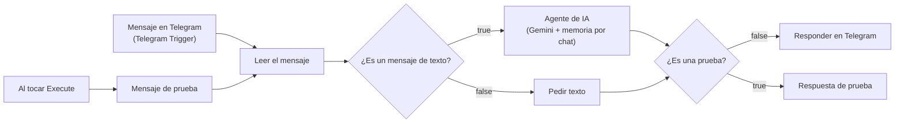

# Bot de Telegram con IA

**Casos de uso · intermedio · 25 minutos · credenciales: Telegram y Google Gemini (las dos gratis) · auditado en n8n 2.48.7**

Tu propio bot de Telegram que conversa con IA. Cada mensaje que le escriben llega a n8n, un [agente](https://github.com/nodo-cero-bo/guias/blob/main/glosario.md#agente) con Gemini lo responde siguiendo tus instrucciones y n8n manda la respuesta al mismo chat. Recuerda los últimos mensajes de cada chat por separado, así que se puede conversar.

Es la base de muchos proyectos: un asistente para una feria, para una junta vecinal, para un curso o para tu emprendimiento. Cambiás las instrucciones y el bot es otro.

## Qué hace



1. **Mensaje en Telegram** recibe cada mensaje nuevo, cuando el workflow está [publicado](https://github.com/nodo-cero-bo/guias/blob/main/glosario.md#publicar). **Al tocar Execute** usa **Mensaje de prueba**, que imita lo que manda Telegram.
2. **Leer el mensaje** saca lo importante: `chat_id` (a qué chat responder), `texto` y `nombre`, y marca `es_prueba`.
3. **¿Es un mensaje de texto?** deja pasar el texto. A una foto, un audio o un sticker, **Pedir texto** les contesta que escriban.
4. **Agente de IA** responde siguiendo su [mensaje de sistema](https://github.com/nodo-cero-bo/guias/blob/main/glosario.md#prompt-y-mensaje-de-sistema). **Memoria por chat** le da los últimos 10 mensajes de esa conversación ([memoria](https://github.com/nodo-cero-bo/guias/blob/main/glosario.md#memoria)).
5. **Responder en Telegram** manda la respuesta al chat. En una prueba, termina en **Respuesta de prueba** y no manda nada.

## Qué aprendés

- A crear un bot con **@BotFather** y conectarlo a n8n.
- **Telegram Trigger** y **Telegram → Send a text message**.
- Un **AI Agent** con instrucciones propias y **memoria separada por chat** (una clave por conversación).
- A probar un bot sin Telegram, con un mensaje que tiene la misma forma.
- A cuidar tu bot: quién puede usarlo y cómo evitar errores de formato.

## Qué necesitás

1. **Un bot de Telegram y su token** (gratis, 5 minutos):
   1. En Telegram, buscá **@BotFather** (tiene la tilde azul de cuenta verificada) y escribile `/newbot`.
   2. Elegí un nombre (lo que se ve, por ejemplo «Asistente de la feria») y un usuario que termine en `bot` (por ejemplo `feria_equipo_bot`).
   3. BotFather te responde con un **token**: números, dos puntos y letras. Es la llave de tu bot: quien la tenga puede hablar en su nombre. No la compartas, no la pegues en el canvas ni la subas a GitHub.
   4. En n8n: **Credentials** → **Add credential** → **Telegram API** (`telegramApi`) → pegá el token en **Access Token**. El **Base URL** dejalo como viene.
2. **La credencial Google Gemini(PaLM) Api** (`googlePalmApi`): una clave gratis de [Google AI Studio](https://aistudio.google.com/). Paso a paso en la guía [Clave de Gemini](https://github.com/nodo-cero-bo/guias/blob/main/00-empezar/07-clave-gemini.md).
3. **Una n8n con dirección pública** (HTTPS): Telegram le avisa a n8n cada mensaje nuevo, y para eso necesita poder llegar. **n8n Cloud ya la tiene.** En tu compu hace falta un túnel.

## Cómo importarlo

1. **Copiar y pegar.** Abrí [`workflow.json`](workflow.json), tocá **Copy raw file** y pegalo con Ctrl + V en un workflow nuevo (o «Copiar workflow» en la [página del evento](https://nodo-cero-bo.github.io)).
2. **Import from URL.** Menú del workflow (los tres puntos) → **Import from URL**:

   ```text
   https://raw.githubusercontent.com/nodo-cero-bo/workflows/main/60-casos-de-uso/66-bot-de-telegram-con-ia/workflow.json
   ```

3. **Import from File.** Bajá el archivo y elegí **Import from File**.

## Cómo probarlo, paso a paso

1. **Cargá las credenciales.** Tres nodos tienen el triángulo de advertencia: en **Mensaje en Telegram** y **Responder en Telegram** elegí tu credencial **Telegram API**, y en **Modelo Gemini** la de **Google Gemini(PaLM) Api**.
2. **Probá sin Telegram.** Tocá **Execute workflow**. Se ponen en verde **Al tocar Execute**, **Mensaje de prueba**, **Leer el mensaje**, el agente y **Respuesta de prueba**. Abrí **Respuesta de prueba**: `output` es lo que el bot le contestaría a «Hola, ¿qué es n8n y qué podría automatizar en mi feria de emprendedoras?».
3. **Cambiá la personalidad.** Abrí **Agente de IA** → **Options** → **System Message**. Ahí dice quién es el bot y cómo habla. Cambialo por el de tu proyecto (para quién es, qué sabe, qué no tiene que hacer) y probá de nuevo.
4. **Encendelo.** Tocá **Publish**. n8n le avisa a Telegram la dirección de **Mensaje en Telegram**.
5. **Escribile.** En Telegram, buscá tu bot por su usuario, tocá **Iniciar** (o escribí `/start`) y mandale «Hola». En unos segundos responde. Mandale después «¿Qué te pregunté recién?»: se acuerda.
6. **Mirá lo que pasó.** En la pestaña **Executions** de n8n hay una ejecución por mensaje. Abrila para ver qué llegó de Telegram y qué respondió el agente.

## Cómo saber que funcionó

- La prueba con **Execute workflow** termina en **Respuesta de prueba** con `output` en español.
- Con el workflow publicado, el bot responde en Telegram y cada mensaje aparece en **Executions**.
- Si le mandás una foto, contesta «Por ahora leo nada más mensajes de texto...».

## Cómo se probó

El workflow pasa el auditor y se importa en n8n 2.48.7. Sin un bot ni una clave reales, se ejecutó contra servidores locales que imitan la API de Gemini y la Bot API de Telegram, con credenciales que apuntaban a ellos: la prueba con **Execute workflow** llegó al agente con el mensaje de sistema y terminó en **Respuesta de prueba**; con el workflow publicado, n8n registró su dirección en Telegram (`setWebhook`, con un secreto), respondió al chat correcto, la segunda pregunta llegó con los dos mensajes anteriores en la memoria, una foto recibió el pedido de texto, un aviso con el secreto equivocado fue rechazado (403) y un texto con `<`, `>` y `&` salió bien escapado.

## Si algo falla

| Lo que ves | Qué pasa | Cómo se arregla |
|---|---|---|
| Al publicar: «Bad Request: bad webhook: An HTTPS URL must be provided» | Tu n8n no tiene una dirección pública con HTTPS. | Usá n8n Cloud o un túnel en tu compu. |
| «Unauthorized» al publicar o al responder | El token está mal copiado o lo cambiaste en BotFather. | Copialo de nuevo en la credencial **Telegram API**. |
| El bot no responde y no hay ejecuciones | El workflow no está publicado, o tocaste **Listen for test event** y Telegram quedó apuntando a la dirección de prueba. | Tocá **Publish** de nuevo: Telegram vuelve a la dirección de producción. Un bot tiene una sola dirección a la vez. |
| Responde en un chat pero no en un grupo | En los grupos, por defecto el bot lee nada más los comandos y las respuestas a sus mensajes. | En BotFather, `/setprivacy` → **Disable**, o mencioná al bot. |
| «Bad Request: can't parse entities» | El texto tenía signos que Telegram toma como formato. | El workflow ya usa **Parse Mode: HTML** y escapa `&`, `<` y `>`. Si cambiaste el nodo, volvé a esa expresión. |
| `429` o «Resource has been exhausted» de Gemini | Pasaste el límite gratis por minuto. | Esperá un minuto. Si el bot es muy usado, restringí quién lo usa (abajo). |

## Cuidar tu bot

- **Quién lo usa**: cualquiera que encuentre el usuario de tu bot puede escribirle y gastar tu cuota de Gemini. Si es para tu grupo, en **Mensaje en Telegram** → **Additional Fields** → **Restrict to Chat IDs** poné el id de tu chat o tu grupo (lo ves en `message.chat.id` de cualquier ejecución).
- **Datos personales**: el mensaje de sistema le pide no pedirlos. No guardes las conversaciones si no hace falta.
- **La memoria simple** vive dentro de n8n y se borra si n8n se reinicia. Para una memoria que dure, guardala en Postgres de Supabase, como en el [workflow 33](../../30-supabase/33-agente-con-memoria-y-rag).

## Ideas para extenderlo

- **Que sepa de tu proyecto**: sumale herramientas al agente, como en el [workflow 40](../../40-proyectos/40-agente-web3-fuji), o tus documentos con RAG ([workflow 33](../../30-supabase/33-agente-con-memoria-y-rag)).
- **«Escribiendo...»**: antes del agente, un **Telegram → Send Chat Action** con `typing`.
- **Que clasifique**: pasá cada mensaje por el [workflow 65](../65-clasificar-mensajes-con-ia) y respondé distinto a consultas y reclamos.
- **Avisos**: el mismo bot puede mandar las alertas del clima del [workflow 60](../60-alerta-del-clima).

## Documentación oficial

- n8n: [Telegram Trigger](https://docs.n8n.io/integrations/builtin/trigger-nodes/n8n-nodes-base.telegramtrigger/), [Telegram](https://docs.n8n.io/integrations/builtin/app-nodes/n8n-nodes-base.telegram/), [credencial de Telegram](https://docs.n8n.io/integrations/builtin/credentials/telegram/), [AI Agent](https://docs.n8n.io/integrations/builtin/cluster-nodes/root-nodes/n8n-nodes-langchain.agent/), [Simple Memory](https://docs.n8n.io/integrations/builtin/cluster-nodes/sub-nodes/n8n-nodes-langchain.memorybufferwindow/) y [Google Gemini Chat Model](https://docs.n8n.io/integrations/builtin/cluster-nodes/sub-nodes/n8n-nodes-langchain.lmchatgooglegemini/).
- Telegram: [cómo crear un bot con BotFather](https://core.telegram.org/bots/features#botfather) y [la Bot API](https://core.telegram.org/bots/api).

---

Licencia MIT, como todo el repo. n8n, Telegram y Google Gemini son marcas de sus dueños.
