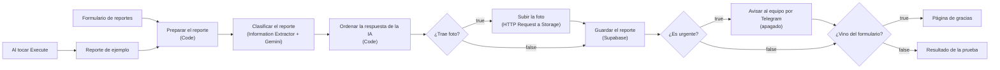

# Reportes ambientales ciudadanos

**Casos de uso · línea Impacto social y ambiental · intermedio · 35 minutos · credenciales: Supabase y Google Gemini (Telegram opcional) · auditado en n8n 2.48.7**

Un formulario para que cualquier vecina reporte un problema ambiental de su barrio (un microbasural, una quema, una cañería rota, un árbol caído, un animal herido), con foto si quiere. La IA lo clasifica, le pone una urgencia y lo resume en una frase; n8n guarda la foto en Supabase Storage y el reporte en una tabla; si es urgente, avisa al equipo por Telegram; y la persona ve una página con el número de su reporte.

Es un proyecto completo para la línea **Impacto social y ambiental**, pensado para Santa Cruz (la sede de Nodo Cero es el Centro de Educación Ambiental) y fácil de llevar a cualquier ciudad.

## Qué hace



1. **Formulario de reportes** pide tres cosas: **¿Qué pasa?**, **¿Dónde?** y una **foto** opcional. No pide nombre, teléfono ni correo.
2. **Preparar el reporte** limpia los textos y, si vino una foto válida (JPG, PNG o WEBP), le arma un nombre único: `2026-11-21/reporte-19-0-fxtvry.png`.
3. **Clasificar el reporte** (**Information Extractor** con Gemini) devuelve `categoria` (basura, quema, agua, arboles, animales, ruido u otro), `urgencia` (alta, media o baja) y `resumen`.
4. **Ordenar la respuesta de la IA** normaliza lo que dijo la IA: si escribió `Basura` o una categoría que no existe, queda `basura` u `otro`. Así la base nunca rechaza el reporte.
5. **Subir la foto** la manda al bucket privado `reportes-fotos` de Supabase Storage. **Guardar el reporte** crea la fila en la tabla `reportes`.
6. **¿Es urgente?** avisa al equipo por Telegram (el nodo viene apagado hasta que tengas tu bot) y **Página de gracias** le muestra a la persona su número de reporte.

## Qué aprendés

- Un **formulario con un archivo opcional** y cómo saber si de verdad vino la foto.
- **Information Extractor**: pedirle a la IA datos con nombre y descripción, en vez de un texto libre.
- A **no confiar a ciegas en la IA**: normalizar su respuesta antes de guardarla.
- A **subir un archivo a Supabase Storage** con HTTP Request y la credencial de Supabase (el nodo Supabase trabaja con tablas, no con archivos).
- A **guardar una fila** con datos de varios nodos con `$('Nombre del nodo').item.json`.
- A **cuidar los datos de quien reporta**: sin datos personales, fotos en un bucket privado.

## Qué necesitás

1. **Un proyecto de Supabase** (el plan gratis alcanza). En el **SQL Editor**, copiá y corré [`supabase/sql/02_reportes.sql`](../../supabase/sql/02_reportes.sql): crea la tabla `reportes`, el bucket privado `reportes-fotos` y la seguridad por filas ([RLS](https://github.com/nodo-cero-bo/guias/blob/main/glosario.md#rls)). Tiene que terminar con «Success. No rows returned». Se puede correr más de una vez.
2. **La credencial Supabase API** (`supabaseApi`): en Supabase, **Project Settings → API Keys**. En **Host** va la URL del proyecto (`https://<tu-proyecto>.supabase.co`, sin `/rest/v1`) y en **Secret Key** una [clave secreta](https://github.com/nodo-cero-bo/guias/blob/main/glosario.md#clave-publicable-y-clave-secreta) `sb_secret_...` (la `service_role` de antes también sirve). Guía: [Cuenta de Supabase](https://github.com/nodo-cero-bo/guias/blob/main/00-empezar/04-cuenta-supabase.md).
3. **La credencial Google Gemini(PaLM) Api** (`googlePalmApi`): una clave gratis de [Google AI Studio](https://aistudio.google.com/). Guía: [Clave de Gemini](https://github.com/nodo-cero-bo/guias/blob/main/00-empezar/07-clave-gemini.md).
4. **Opcional, para el aviso**: la credencial **Telegram API** (`telegramApi`) con el token de tu bot. El [workflow 66](../66-bot-de-telegram-con-ia) explica cómo crearlo.

> La clave secreta de Supabase saltea RLS: con ella se lee y se escribe todo. Va nada más en la credencial de n8n. Nunca en una página web, en una app, en una captura ni en un repo.

## Cómo importarlo

1. **Copiar y pegar.** Abrí [`workflow.json`](workflow.json), tocá **Copy raw file** y pegalo con Ctrl + V en un workflow nuevo (o «Copiar workflow» en la [página del evento](https://nodo-cero-bo.github.io)).
2. **Import from URL.** Menú del workflow (los tres puntos) → **Import from URL**:

   ```text
   https://raw.githubusercontent.com/nodo-cero-bo/workflows/main/60-casos-de-uso/67-reportes-ambientales/workflow.json
   ```

3. **Import from File.** Bajá el archivo y elegí **Import from File**.

## Cómo probarlo, paso a paso

1. **Corré el SQL** en Supabase (si todavía no lo hiciste) y revisá: en **Table Editor** aparece `reportes` y en **Storage** el bucket `reportes-fotos` con el candado de privado.
2. **Cargá las credenciales.** En **Modelo Gemini**, la de Gemini. En **Guardar el reporte** y en **Subir la foto**, la de Supabase (en **Subir la foto** ya está elegido el tipo **Supabase API**: nada más elegí tu credencial).
3. **Poné tu proyecto en la URL de la foto.** En **Subir la foto**, la URL empieza con `https://TU-PROYECTO.supabase.co`. Cambiá `TU-PROYECTO` por el de tu proyecto (es lo mismo que pusiste en **Host** de la credencial).
4. **Probá con el ejemplo.** Tocá **Execute workflow**. Se ponen en verde **Reporte de ejemplo**, la IA, **Guardar el reporte** y **Resultado de la prueba**. **Subir la foto** queda gris porque el ejemplo no trae foto. Abrí **Clasificar el reporte**: el `output` tiene `categoria`, `urgencia` y `resumen`. El ejemplo habla de basura quemada al lado de una escuela, así que lo esperable es `quema` (o `basura`) con urgencia `alta`.
5. **Mirá la fila.** En Supabase, **Table Editor → reportes**: hay una fila nueva con `origen` = `prueba`, `estado` = `nuevo` y `foto_ruta` vacía. Podés borrarla cuando quieras.
6. **El formulario de verdad.** Tocá **Publish**, abrí **Formulario de reportes** y copiá la **Production URL**. En el navegador vas a ver «Reportá un problema ambiental» con los colores de Nodo Cero. Completalo, subí una foto (sin caras ni patentes) y enviá. La página dice «Gracias por tu reporte», el número y cómo lo clasificó la IA.
7. **Mirá la foto.** En Supabase, **Storage → reportes-fotos**: hay una carpeta con la fecha y adentro la foto. En la tabla, `foto_ruta` dice dónde está.
8. **Opcional, el aviso.** Creá tu bot y sumalo al grupo del equipo. En **Avisar al equipo por Telegram**, elegí la credencial y cambiá `TU_CHAT_ID` por el id del grupo. Seleccioná el nodo y prendelo con la tecla **D**. Desde ahí, cada reporte urgente llega al grupo.

## Cómo saber que funcionó

- **Guardar el reporte** devuelve la fila con su `id` y `creado_en`.
- La fila está en **Table Editor → reportes** con una categoría y una urgencia válidas.
- Con foto, el archivo está en **Storage → reportes-fotos** y `foto_ruta` lo nombra.
- La persona ve la página de gracias con el mismo número que la fila.

## Cómo se probó

El SQL se corrió tres veces seguidas en Postgres (PGlite), con los roles de Supabase y la tabla `storage.buckets` simulados, y pasó 17 pruebas: es idempotente, crea el bucket una vez y privado, `service_role` crea, lee y actualiza reportes (también sin foto), las reglas `check` rechazan categorías, urgencias y descripciones inválidas, la clave pública no lee ni escribe (error 42501) y el bloque comentado para mostrar reportes en un mapa funciona si se descomenta.

El workflow pasa el auditor y se importa en n8n 2.48.7. Sin cuentas reales, se ejecutó de punta a punta contra servidores locales que imitan las API de Gemini, Supabase (tablas y Storage) y Telegram, con credenciales que apuntaban a ellos: la prueba con **Execute workflow** guardó la fila sin foto y, con el aviso prendido, mandó el mensaje al grupo; con el workflow publicado, un reporte con foto subió la imagen (con las cabeceras de la credencial y el tipo `image/png`) y guardó su ruta, uno sin foto no intentó subir nada, y los dos mostraron la página de gracias con su número.

## Si algo falla

| Lo que ves | Qué pasa | Cómo se arregla |
|---|---|---|
| **Guardar el reporte**: «relation "public.reportes" does not exist» | Falta correr el SQL. | Corré `02_reportes.sql` en el SQL Editor. |
| **Guardar el reporte**: «permission denied for table reportes» (42501) | La credencial usa la clave pública, no la secreta. | En **Secret Key** va la `sb_secret_...` (o la `service_role`). |
| **Guardar el reporte**: «violates check constraint» | Llegó un valor que la tabla no acepta. | Revisá que **Ordenar la respuesta de la IA** esté conectado antes de guardar. |
| **Subir la foto**: `ENOTFOUND tu-proyecto.supabase.co` | Quedó `TU-PROYECTO` en la URL. | Poné el nombre de tu proyecto. |
| **Subir la foto**: «Bucket not found» | No se creó el bucket. | Corré el SQL de nuevo y mirá **Storage**. |
| **Subir la foto**: «Payload too large» o «mime type not supported» | La foto pesa más de 5 MB o no es JPG, PNG ni WEBP. | Pedí fotos más livianas o cambiá `file_size_limit` en el SQL. |
| **Clasificar el reporte**: `API key not valid` o `429` | La clave de Gemini está mal o pasaste el límite gratis por minuto. | Revisá la clave o esperá un minuto. |
| La ejecución se queda en «Waiting» | Un nodo **n8n Form** espera a alguien del otro lado. | No saques el IF **¿Vino del formulario?**. |

## Cuidar a quien reporta

- El formulario **no pide datos personales** y lo dice. Si alguien escribe su nombre o su teléfono en la descripción, quedan guardados: avisá en el formulario y borralos al revisar.
- Las fotos van a un **bucket privado**: no tienen enlace público. Una foto de la calle puede mostrar caras, casas o patentes.
- **¿Querés un mapa público de reportes?** El final de [`02_reportes.sql`](../../supabase/sql/02_reportes.sql) tiene, comentado y probado, cómo mostrar nada más la categoría, la urgencia, el lugar y el estado, sin la descripción ni la foto.

## Ideas para extenderlo

- **Que la IA mire la foto**: con un **Basic LLM Chain** y un mensaje de tipo **Image (Binary)**, Gemini puede describir lo que se ve y confirmar la categoría.
- **Un mapa**: sumá un campo de ubicación y mostralos en una página con la vista pública del SQL.
- **Un resumen semanal**: un **Schedule Trigger** que cuente los reportes por categoría y urgencia y lo mande al grupo.
- **Seguimiento**: el campo `estado` (nuevo, en_revision, resuelto, descartado) está listo para una pantalla del equipo hecha con Supabase, o con login usando Clerk.
- **En quechua, aimara o guaraní**: traducí el formulario y la página de gracias para llegar a más personas.

## Documentación oficial

- n8n: [Information Extractor](https://docs.n8n.io/integrations/builtin/cluster-nodes/root-nodes/n8n-nodes-langchain.information-extractor/), [Supabase](https://docs.n8n.io/integrations/builtin/app-nodes/n8n-nodes-base.supabase/), [HTTP Request](https://docs.n8n.io/integrations/builtin/core-nodes/n8n-nodes-base.httprequest/), [n8n Form Trigger](https://docs.n8n.io/integrations/builtin/core-nodes/n8n-nodes-base.formtrigger/), [n8n Form](https://docs.n8n.io/integrations/builtin/core-nodes/n8n-nodes-base.form/) y [Telegram](https://docs.n8n.io/integrations/builtin/app-nodes/n8n-nodes-base.telegram/).
- Supabase: [Storage](https://supabase.com/docs/guides/storage), [subir archivos](https://supabase.com/docs/guides/storage/uploads/standard-uploads), [seguridad por filas (RLS)](https://supabase.com/docs/guides/database/postgres/row-level-security) y [claves de API](https://supabase.com/docs/guides/getting-started/api-keys).

---

Licencia MIT, como todo el repo. Los reportes de ejemplo son inventados. n8n, Supabase, Telegram y Google Gemini son marcas de sus dueños.
