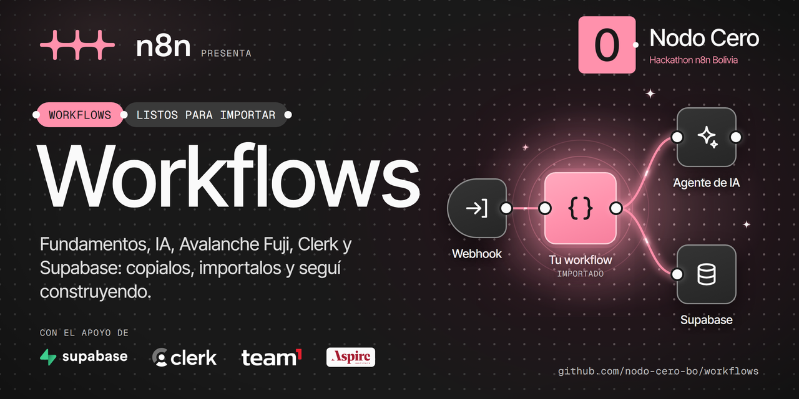

<p align="center">
  
</p>

<p align="center">
  <a href="https://github.com/nodo-cero-bo/workflows/actions/workflows/auditar.yml"></a>
  
  
  <a href="LICENSE"></a>
</p>

<p align="center">
  <a href="https://nodo-cero-bo.github.io"><b>Página con el catálogo</b></a> ·
  <a href="https://github.com/nodo-cero-bo/guias">Guías</a> ·
  <a href="https://github.com/nodo-cero-bo/proyectos">Proyectos</a> ·
  <a href="https://github.com/nodo-cero-bo/proyectos/issues/new?template=proyecto.yml">Registrá tu proyecto</a>
</p>

# Workflows de Nodo Cero

Los workflows de n8n de **Nodo Cero – Hackathon n8n Bolivia**, listos para importar. Nodo Cero es la hackathon de la comunidad n8n en Bolivia, enfocada en mujeres, de la mano de Women Techmakers Santa Cruz: sábado 21 de noviembre de 2026, en el Centro de Educación Ambiental (CEA) de Santa Cruz de la Sierra.

Cada workflow es un punto de partida para tu proyecto: importalo, conectá tus credenciales, probalo y cambialo hasta que sea tuyo. Están pensados para aprender mientras los usás.

## Qué hay en cada carpeta

Cada workflow vive en `<categoría>/<id>/` y trae:

- **`workflow.json`**: el workflow para importar. Adentro tiene **notas adhesivas en español**: una grande al inicio con qué hace, qué necesitás y cómo probarlo, y otras al lado de los pasos clave que explican el porqué. No trae credenciales ni claves: n8n te las pide al importar.
- **`README.md`**: qué hace, qué aprendés, qué cuentas y credenciales necesitás, cómo probarlo paso a paso, ideas para extenderlo y enlaces a la documentación oficial.
- **`meta.json`**: los datos que lee la [página](https://nodo-cero-bo.github.io) para armar el catálogo (nivel, minutos, tecnologías, credenciales y estado).

Además, en la raíz del repo:

- [`tools/`](tools): el auditor y las pruebas en una n8n local.
- [`docs/`](docs): la [referencia de nodos de n8n 2.48.7](docs/REFERENCIA_NODOS.md) que usan los workflows y el [resultado de las pruebas](docs/PRUEBAS.md).

## Cómo importar un workflow

Hay tres formas. Las tres dejan el mismo workflow en tu canvas.

**1. Copiar y pegar (la más rápida).** En la [página](https://nodo-cero-bo.github.io), tocá «Copiar workflow» en la tarjeta que quieras. También podés abrir el `workflow.json` acá en GitHub y usar el botón «Copy raw file». Después, en n8n, abrí un workflow nuevo, hacé clic en el canvas y pegá con Ctrl + V (Cmd + V en Mac).

**2. Import from URL.** En n8n, abrí un workflow nuevo y, en el encabezado del canvas, el menú del workflow (los tres puntos). Elegí **Import from URL** y pegá el enlace crudo del archivo. Tiene esta forma:

```text
https://raw.githubusercontent.com/nodo-cero-bo/workflows/main/<categoría>/<id>/workflow.json
```

Por ejemplo, el primero: `https://raw.githubusercontent.com/nodo-cero-bo/workflows/main/00-fundamentos/01-hola-n8n/workflow.json`. En la página, el botón «Copiar enlace crudo» te lo copia.

**3. Import from File.** Bajá el `workflow.json` (botón «Download raw file» en GitHub o «Descargar» en la página). En n8n, menú del workflow → **Import from File**, y elegí el archivo.

**Después de importar:** abrí cada nodo que muestre una advertencia y elegí o creá la credencial que pide. La nota grande del inicio y el README de la carpeta dicen cuál es y dónde se saca. Paso a paso, en las guías: [importar workflows](https://github.com/nodo-cero-bo/guias/blob/main/00-empezar/02-importar-workflows.md) y [conectar credenciales](https://github.com/nodo-cero-bo/guias/blob/main/00-empezar/03-credenciales.md). La documentación oficial de n8n lo explica en [Export and import workflows](https://docs.n8n.io/build/manage-workflows/export-and-import).

## Catálogo

<!-- catalogo:inicio -->

**23 workflows en 5 categorías** · 11 ejecutados de verdad y 12 auditados.

### [Fundamentos](00-fundamentos) · 5 workflows

Para arrancar de cero: datos, expresiones, tu primera API, HTTP Request, formularios y tu primer agente de IA. Ninguno pide credenciales, salvo el agente (una clave gratis de Google AI Studio).

| Workflow | Qué hace | Nivel | Credenciales | Estado |
|---|---|---|---|---|
| [`01-hola-n8n`](00-fundamentos/01-hola-n8n) | **Hola n8n: datos, expresiones y decisiones**<br>Tu primer workflow: armá datos, transformalos con JavaScript y tomá una decisión con IF. | inicial<br>10 min | ninguna |  |
| [`02-mi-primera-api`](00-fundamentos/02-mi-primera-api) | **Tu primera API**<br>Un Webhook que recibe tu nombre y responde un saludo en JSON: tu propia API en cinco nodos. | inicial<br>10 min | ninguna |  |
| [`03-http-request`](00-fundamentos/03-http-request) | **Llamar a cualquier API con HTTP Request**<br>Consultá el clima de Santa Cruz y el último bloque de Avalanche Fuji, y leé cada respuesta. | inicial<br>15 min | ninguna |  |
| [`04-formulario`](00-fundamentos/04-formulario) | **Un formulario de n8n**<br>Un formulario con los colores de Nodo Cero que procesa la respuesta y muestra una página final para cada persona. | inicial<br>10 min | ninguna |  |
| [`05-agente-ia`](00-fundamentos/05-agente-ia) | **Tu primer agente de IA**<br>Un agente que conversa en el chat de n8n con Google Gemini, recuerda la conversación y responde como el asistente de Nodo Cero. | inicial<br>15 min | Google Gemini(PaLM) Api |  |

### [Avalanche Fuji](10-avalanche-fuji) · 7 workflows

Leé la red de prueba de Avalanche con su RPC público: sin cuentas y sin claves privadas. Es el track de Avalanche Fuji, con mención especial para los equipos que lo integren.

> **Antes de empezar con Fuji:** [Descargá Core Wallet](https://core.app/?utm_source=nodo-cero&utm_medium=github&utm_campaign=hackathon-n8n-bolivia-2026) y activá el modo testnet · [Pedí AVAX de prueba en el faucet](https://build.avax.network/console/primary-network/faucet) · [Aprendé en Avalanche Academy](https://build.avax.network/academy?utm_source=nodo-cero&utm_medium=github&utm_campaign=hackathon-n8n-bolivia-2026) · [Sumate a Team1](https://www.team1.network/?utm_source=nodo-cero&utm_medium=github&utm_campaign=hackathon-n8n-bolivia-2026) · [Explorá tus transacciones](https://build.avax.network/explorer/fuji/c-chain)
>
> Red: Avalanche Fuji C-Chain · chainId `43113` (`0xa869`) · RPC público `https://api.avax-test.network/ext/bc/C/rpc`

| Workflow | Qué hace | Nivel | Credenciales | Estado |
|---|---|---|---|---|
| [`10-fuji-estado-de-la-red`](10-avalanche-fuji/10-fuji-estado-de-la-red) | **Estado de la red Fuji**<br>chainId, último bloque y precio del gas de Fuji, en números legibles. | inicial<br>10 min | ninguna |  |
| [`11-fuji-saldo-wallet`](10-avalanche-fuji/11-fuji-saldo-wallet) | **Saldo de una wallet en Fuji**<br>Pasale una dirección y te devuelve su saldo en AVAX, por API o con un formulario. | inicial<br>15 min | ninguna |  |
| [`12-fuji-leer-transaccion`](10-avalanche-fuji/12-fuji-leer-transaccion) | **Leer una transacción en Fuji**<br>El desafío del día: dado un hash, quién envió, a quién, cuánto, gas, estado, bloque, confirmaciones y enlace al explorador. | inicial<br>15 min | ninguna |  |
| [`13-fuji-verificar-pago`](10-avalanche-fuji/13-fuji-verificar-pago) | **Verificar un pago en Fuji**<br>Valida estado, destino, monto y confirmaciones de un pago, y responde si está verificado. | intermedio<br>20 min | Supabase API (opcional) |  |
| [`14-fuji-monitor-wallet`](10-avalanche-fuji/14-fuji-monitor-wallet) | **Monitor de una wallet en Fuji**<br>Revisa un saldo cada 5 minutos y arma un aviso cuando cambia. | intermedio<br>15 min | ninguna |  |
| [`15-fuji-token-erc20`](10-avalanche-fuji/15-fuji-token-erc20) | **Saldo de un token ERC-20 en Fuji**<br>Nombre, símbolo, decimales y saldo de un token ERC-20 con eth_call, con el USDC de prueba de Circle. | intermedio<br>20 min | ninguna |  |
| [`16-fuji-eventos-contrato`](10-avalanche-fuji/16-fuji-eventos-contrato) | **Leer eventos de un contrato en Fuji**<br>Trae eventos con eth_getLogs y los decodifica: transferencias de tokens y los registros de tu propio contrato. | avanzado<br>25 min | ninguna |  |

### [Clerk](20-clerk) · 3 workflows

Login y usuarias con Clerk conectado a n8n: webhooks firmados, una API que exige sesión e invitaciones. Hay mención al mejor uso de Clerk.

| Workflow | Qué hace | Nivel | Credenciales | Estado |
|---|---|---|---|---|
| [`20-clerk-webhook-a-supabase`](20-clerk/20-clerk-webhook-a-supabase) | **De Clerk a Supabase con un webhook**<br>Cada alta, cambio o baja de usuaria en Clerk llega firmada a n8n, que verifica la firma Svix y mantiene al día la tabla perfiles de Supabase. | intermedio<br>20 min | Supabase API |  |
| [`21-clerk-api-protegida`](20-clerk/21-clerk-api-protegida) | **Una API protegida con Clerk**<br>Una API de n8n que verifica el token de sesión de Clerk (RS256) y devuelve el perfil desde Supabase; sin sesión válida, responde 401. | avanzado<br>25 min | JWT Auth con la clave pública de Clerk, Supabase API |  |
| [`22-clerk-invitaciones`](20-clerk/22-clerk-invitaciones) | **Invitaciones con Clerk**<br>Pegá una lista de correos en un formulario y n8n invita a cada persona con la Backend API de Clerk, con un resumen de lo que salió bien y lo que no. | intermedio<br>15 min | Clerk Backend API |  |

### [Supabase](30-supabase) · 5 workflows

Postgres, tu propia API y búsqueda en tus documentos con pgvector. El esquema de las tablas está en [`supabase/sql/`](supabase/sql).

| Workflow | Qué hace | Nivel | Credenciales | Estado |
|---|---|---|---|---|
| [`30-formulario-a-supabase`](30-supabase/30-formulario-a-supabase) | **Formulario a Supabase**<br>Lo que llega por un formulario queda guardado como fila en Supabase. | inicial<br>15 min | Supabase API |  |
| [`31-api-crud-supabase`](30-supabase/31-api-crud-supabase) | **Una API sobre Supabase**<br>Listá y creá filas de Supabase desde tu propia API. | intermedio<br>20 min | Supabase API |  |
| [`32-cargar-documentos-rag`](30-supabase/32-cargar-documentos-rag) | **Cargar documentos para RAG**<br>Subí un archivo, partilo en trozos y guardá sus embeddings en Supabase. | intermedio<br>25 min | Supabase API, Google Gemini(PaLM) Api |  |
| [`33-agente-con-memoria-y-rag`](30-supabase/33-agente-con-memoria-y-rag) | **Agente con memoria y tus documentos**<br>Un agente que recuerda la conversación y busca en tus documentos. | avanzado<br>30 min | Google Gemini(PaLM) Api, Postgres (Supabase), Supabase API |  |
| [`34-supabase-webhook-ia`](30-supabase/34-supabase-webhook-ia) | **La IA clasifica cada fila nueva**<br>Un Database Webhook avisa a n8n y la IA completa la fila. | intermedio<br>20 min | Supabase API, Google Gemini(PaLM) Api, Header Auth |  |

### [Proyectos completos](40-proyectos) · 3 workflows

Juntan varias piezas de punta a punta, para partir de algo grande y hacerlo tuyo.

| Workflow | Qué hace | Nivel | Credenciales | Estado |
|---|---|---|---|---|
| [`40-agente-web3-fuji`](40-proyectos/40-agente-web3-fuji) | **Agente de IA para Fuji**<br>Un chat con IA que lee Avalanche Fuji en vivo: saldos, transacciones y el último bloque, explicados en español. | avanzado<br>30 min | Google Gemini(PaLM) Api |  |
| [`41-pagos-fuji-con-login`](40-proyectos/41-pagos-fuji-con-login) | **Pagos en Fuji con login**<br>Login con Clerk, la persona manda el hash de su pago, n8n lo verifica en Fuji y lo registra en Supabase a su nombre. | avanzado<br>40 min | Supabase API |  |
| [`42-reporte-kpis`](40-proyectos/42-reporte-kpis) | **Reporte de KPIs del evento**<br>Cuenta los proyectos por tecnología, trae el tráfico de los repos y verifica los hashes en Fuji: un informe listo para los aliados. | intermedio<br>20 min | GitHub API |  |

### Material de apoyo

| Carpeta | Qué tiene |
|---|---|
| [`supabase/sql/`](supabase/sql) | El esquema de Supabase: tablas `perfiles`, `ideas`, `pagos_fuji` y `documentos` (pgvector), la función de búsqueda y la seguridad por filas (RLS) explicada. |
| [`clerk/app-ejemplo/`](clerk/app-ejemplo) | Una página mínima con Clerk que inicia sesión y llama a un webhook protegido de n8n con el token de sesión: el circuito login → n8n → Supabase. |
| [`avalanche/contratos/`](avalanche/contratos) | Un contrato simple en Solidity, la guía para desplegarlo en Fuji con Remix y Core Wallet, y cómo leer sus eventos con el workflow 16. |

<!-- catalogo:fin -->

## Qué significan las insignias

| Insignia | Qué quiere decir |
|---|---|
|  | **Corrió de verdad** en una instalación local de n8n 2.48.7 y dio el resultado esperado. Los de Fuji leyeron la red pública en vivo. Lo que se probó y lo que salió está en [docs/PRUEBAS.md](docs/PRUEBAS.md). |
|  | **Pasa el auditor e importa** en n8n 2.48.7, pero necesita tus cuentas (Supabase, Clerk, Google Gemini o GitHub) para correr. Probalo con tus credenciales siguiendo su README. |

Los dos estados pasan las mismas revisiones del auditor. La diferencia es si se pudo ejecutar sin cuentas.

## Versión de n8n

Los workflows apuntan a **n8n Cloud con n8n 2.48.7**, la última versión estable al 21 de noviembre de 2026. Cada nodo usa la `typeVersion` más alta de esa versión y los nombres exactos de sus parámetros, sacados del paquete instalado y no de la memoria: están en [docs/REFERENCIA_NODOS.md](docs/REFERENCIA_NODOS.md).

- **n8n Cloud**: creá tu cuenta en [app.n8n.cloud/register](https://app.n8n.cloud/register) e importá.
- **n8n en tu compu**: con la misma versión (por ejemplo `npx n8n@2.48.7`), o mirá las [opciones de instalación](https://docs.n8n.io/deploy/host-n8n/install-options/install-with-npm).
- Con una versión más vieja, algún nodo puede abrirse con advertencias. Actualizá n8n o probalo en n8n Cloud.

## El auditor

Cada `workflow.json` y cada `meta.json` pasan por [`tools/auditar.mjs`](tools/auditar.mjs), que los compara contra los paquetes de nodos de n8n 2.48.7. Revisa:

- que cada tipo de nodo exista y que su `typeVersion` esté soportada;
- que los parámetros sean los que conoce esa versión del nodo;
- que las conexiones apunten a nodos que existen;
- que no haya credenciales con id ni claves escritas en el JSON;
- que estén las notas adhesivas que enseñan;
- las reglas de texto del evento y que el `meta.json` sea válido y coherente con su workflow.

Si algo falla, termina con un código distinto de cero. Para correrlo en tu compu, con Node 22 o más nuevo:

```bash
git clone https://github.com/nodo-cero-bo/workflows.git
cd workflows
npm install --no-audit --no-fund --ignore-scripts   # trae n8n 2.48.7, contra el que se audita
npm run auditar
```

En GitHub lo corre la acción [Auditar workflows](.github/workflows/auditar.yml) en cada push y en cada pull request: es la insignia «Auditor» de arriba. Las pruebas en una n8n local (`npm run probar`) importan todos los workflows, ejecutan los que no necesitan cuentas y anotan el resultado en [docs/PRUEBAS.md](docs/PRUEBAS.md).

## Cómo sumar o mejorar un workflow

1. Hacé un fork del repo y creá una rama.
2. Armá la carpeta `<categoría>/<id>/` con `workflow.json`, `README.md` y `meta.json`, como las que ya están.
3. Al exportar desde n8n, revisá el JSON: sacá el `id` del workflow, las credenciales con id y cualquier clave (si pegaste un comando cURL en un HTTP Request, puede traer encabezados con claves). n8n pide las credenciales al importar.
4. Nombres de nodos en español, cortos y claros, notas adhesivas que expliquen el porqué y el canvas prolijo, de izquierda a derecha.
5. Corré `npm run auditar` hasta que pase y abrí un pull request contando qué hace y cómo lo probaste.

¿Encontraste un error o algo que no se entiende? Abrí un issue en este repo con el id del workflow.

## Licencia y marcas

Los workflows, el código y los textos de este repo están bajo la licencia [MIT](LICENSE): usalos, cambialos y compartilos.

n8n, Supabase, Clerk, Avalanche, Core, Team1, Aspire Institute, Google Gemini, Women Techmakers y los demás nombres y logos que aparecen acá son marcas de sus dueños. Los logos de la imagen de cabecera son los oficiales de cada marca, tal cual (el de Aspire Institute, que no tiene versión para fondo oscuro, va sobre una placa clara), se usan para nombrar a quienes apoyan el evento y no entran en la licencia de este repo.
